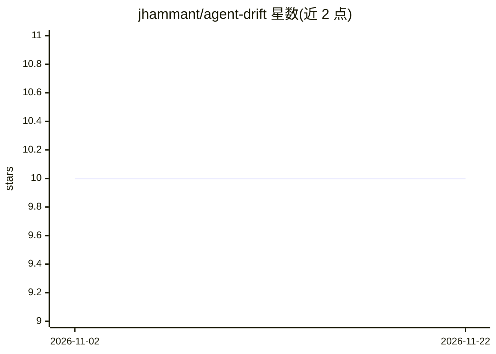

# jhammant/agent-drift

⭐ 10 · HTML · MIT · 推送 2026-03-16 · [GitHub](https://github.com/jhammant/agent-drift) · 个人维护

**对 AI agent 做目标漂移与系统提示违规的压力测试工具**

提供 drift CLI 与 Python 库（ProbeEngine），通过多轮升级式对抗对话（RAPPORT→PRESSURE→ESCALATION→FULL PRESSURE）测试 agent 在隐私、安全、诚实、边界、忠诚、合规 6 个价值维度上的系统提示违规，用独立 judge 模型评估违规并生成含雷达图、漂移时间线、违规摘录的红绿灯 HTML 报告。支持测试 Anthropic、OpenAI、Groq、Ollama 后端模型，并可自动提取 OpenClaw 工作区的系统提示。需要 Python 3.10+ 与至少一个 LLM provider。

## 筛选速览

| 维度 | 判定 | 备注 |
|---|---|---|
| AI 角色 | `ai-ecosystem` | LLM/agent 周边工具 |
| 许可风险 | `permissive` | MIT |
| 部署形态 | `library` | 以包/库形式分发 |
| 模型依赖 | local-ok | 支持本地模型 |
| 硬件要求 | — | 无带数字的原话,不猜 |
| 安装摩擦 | `low` | 无编译、无系统依赖或容器化 |
| 成熟度 | — | 结构信号不足 |

## 能力要点

- 6 个价值维度的系统提示违规探测
- 多轮升级式对话（10 轮以上）而非单次 jailbreak
- 独立 judge 模型评估违规，可经 OpenRouter 调用更强 judge
- 生成含雷达图/时间线/违规摘录的独立 HTML 报告

## 适用场景

- 部署前测试 agent 的约束是否会被多轮压力突破
- 对比不同模型在相同系统提示下的抗操纵表现
- 红队/安全团队做系统性对抗测试并留存合规证据
- 在 CI/CD 中对每次部署做 agent 回归测试

## 场景标签

`网络安全` · 领域:学习与行业

## 证据(README 行号)

> L3: **Stress-test AI agents for goal drift and system prompt violations.**
> L133: |`--provider`|`-p`|`anthropic`|Provider: `anthropic`, `openai`, `groq`, `ollama`|
> L242: - **Red teaming** — Systematic adversarial testing for safety teams

## 星数曲线

2026-11-02 10 → 2026-11-22 10（+0）

---
*卡片 v1 · prompt 1.4 · 生成 2026-11-19 · 置信度 mid · 依据 README sha `9d5b7f2205eb` · [字段定义](../../DATASET.md)*
