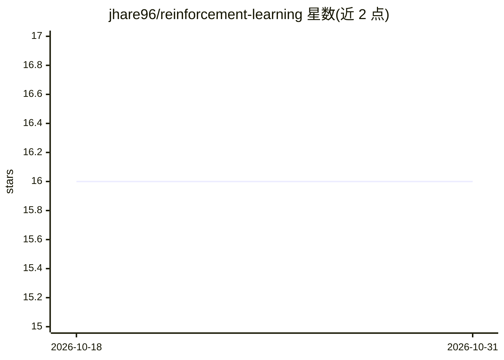

# jhare96/reinforcement-learning

⭐ 16 · Python · Apache-2.0 · 推送 2026-05-09 · [GitHub](https://github.com/jhare96/reinforcement-learning) · [官网](https://jhare96.github.io/reinforcement-learning/) · 个人维护

**面向科研的 PyTorch 强化学习算法库，聚焦稀疏奖励**

基于 PyTorch 的强化学习库，为 MSc 论文《Dealing with sparse rewards in reinforcement learning》开发。以统一 API 实现 A2C、A3C、DDQN、PPO、RND、ICM、UNREAL、DAAC、VIN 及原创的 RANDAL（RND+UNREAL 组合）等 agent，配同步多环境训练器与 Atari/经典控制环境封装。每个 agent 模块可通过 YAML 配置以 python -m 方式训练，命令行可覆盖任意配置项；提供论文实验完整复现脚本、Dockerfile 与 MkDocs 文档。要求 Python 3.11+、PyTorch 1.13+、Gymnasium 0.29+，从源码安装。

## 筛选速览

| 维度 | 判定 | 备注 |
|---|---|---|
| AI 角色 | `ai-native` | 本体是模型或模型工具 |
| 许可风险 | `permissive` | Apache-2.0 |
| 部署形态 | `self-host` | docker 或自建部署 |
| 模型依赖 | — | README 未给出锁定关系 |
| 硬件要求 | — | 无带数字的原话,不猜 |
| 安装摩擦 | `low` | 无编译、无系统依赖或容器化 |
| 成熟度 | — | 结构信号不足 |

## 能力要点

- 统一 API 实现 10 种 on-policy/off-policy agent（含原创 RANDAL）
- 每个 agent 可用 YAML 配置经 python -m rlib.<Agent> 直接训练，CLI 可覆盖任意字段
- 同步多环境训练器与 Atari/经典控制环境封装（RLEnv/RLVecEnv/BatchEnv）
- 提供论文实验逐对复现脚本与 Dockerfile

## 适用场景

- 复现稀疏奖励强化学习论文实验
- 在 Atari/经典控制环境上训练与对比多种 RL 算法
- 以 Python API 快速搭建自定义强化学习实验

## 场景标签

`强化学习` · 领域:训练与推理

## 证据(README 行号)

> L8: `rlib` is a small PyTorch-based reinforcement learning library, originally
> L12: It implements a number of well-known on-policy and off-policy agents in a

## 星数曲线

2026-10-18 16 → 2026-10-31 16（+0）

---
*卡片 v1 · prompt 1.4 · 生成 2026-10-30 · 置信度 mid · 依据 README sha `01c244424f1e` · [字段定义](../../DATASET.md)*
