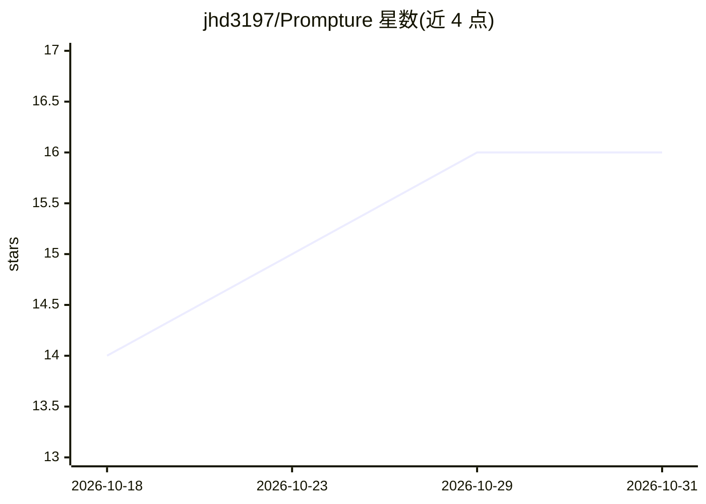

# jhd3197/Prompture

⭐ 16 · Python · MIT · 推送 2026-10-28 · [GitHub](https://github.com/jhd3197/Prompture) · [官网](https://jhd3197.github.io/Prompture/) · 个人维护

**Python 库：从 LLM 提取经验证的 JSON 结构化输出，统一多提供商接口**

Prompture 是一个 API 优先的 Python 库，核心是把 LLM 响应转为按 schema/Pydantic 验证的类型化输出，内置 JSON 修复、token 与成本统计。统一 provider/model 字符串接入 30+ 提供商（OpenAI、Claude、Google、Groq、Ollama 等），本地运行时（Ollama、LM Studio）免密钥即用。附加层包括 Agent/DeepAgent/RAG 管道、提示注入与 PII 防护、批式跨模型测试、OpenAI 兼容 serve 模式与桌面用量监控应用。核心包 pip 安装，其余组件均以 opt-in extras 按需安装。

## 筛选速览

| 维度 | 判定 | 备注 |
|---|---|---|
| AI 角色 | `ai-ecosystem` | LLM/agent 周边工具 |
| 许可风险 | `permissive` | MIT |
| 部署形态 | `desktop` | 安装包/桌面程序 |
| 模型依赖 | local-ok | 支持本地模型 |
| 硬件要求 | — | 无带数字的原话,不猜 |
| 安装摩擦 | `medium` | 含编译或系统依赖之一 |
| 成熟度 | — | 结构信号不足 |

## 能力要点

- JSON schema 强制与 Pydantic 模型直接填充，含自动 JSON 修复
- 36+ 提供商统一 provider/model 字符串接入，含 Ollama/LM Studio 本地免费路径
- 策略级联自动选择 JSON 模式/工具调用提取/提示修复，多模型回退
- prompture serve 提供 OpenAI 兼容端点，路由任意客户端到任意提供商

## 适用场景

- 从 LLM 回答中可靠拿到符合 schema 的结构化数据
- 跨多个模型提供商做统一的提取与对比测试
- 在本地 Ollama 上跑结构化提取，不依赖 API key
- 为多租户应用按运行时传入密钥调用多家提供商

## 场景标签

`模型网关` · 领域:Agent 开发

## 证据(README 行号)

> L11: **Prompture** is a Python library that turns LLM responses into validated, structured data. Define a schema or Pyda
> L87: - 36+ providers under a unified `provider/model` string — see Providers
> L124: - `prompture serve` — OpenAI-compatible server (`/v1/chat/completions`, `/v1/embeddings`, `/v1/coding-agents`, …) 

## 星数曲线

2026-10-18 14 → 2026-10-31 16（+2）

---
*卡片 v1 · prompt 1.4 · 生成 2026-10-30 · 置信度 mid · 依据 README sha `960a284f74f7` · [字段定义](../../DATASET.md)*
