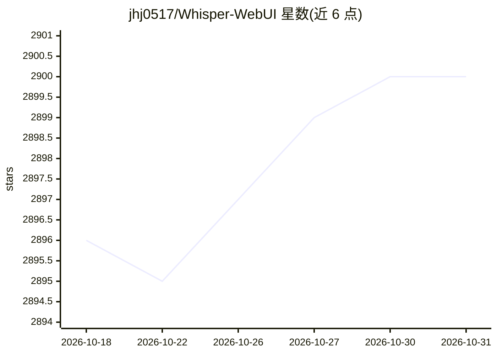

# jhj0517/Whisper-WebUI

⭐ 2,900 · Python · Apache-2.0 · 推送 2025-12-29 · [GitHub](https://github.com/jhj0517/Whisper-WebUI) · 个人维护

**Whisper 语音转写字幕的 Gradio 网页界面**

基于 Gradio 的浏览器界面，封装 Whisper 语音识别模型生成字幕：支持 openai/whisper、faster-whisper（默认）、insanely-fast-whisper 三种实现，可从文件、YouTube、麦克风输入，输出 SRT/WebVTT/txt 格式；支持语音到英文翻译、NLLB/DeepL 字幕文本翻译，以及 Silero VAD、UVR 人声分离、pyannote 说话人分离等前后处理。面向需要本地/自托管字幕生成的用户，提供 Pinokio、Docker、本地脚本三种运行方式，默认假定 Nvidia GPU 与 CUDA 12.8，另有 REST API 部署目录。

## 筛选速览

| 维度 | 判定 | 备注 |
|---|---|---|
| AI 角色 | `ai-native` | 本体是模型或模型工具 |
| 许可风险 | `permissive` | Apache-2.0 |
| 部署形态 | `self-host` | docker 或自建部署 |
| 模型依赖 | — | README 未给出锁定关系 |
| 硬件要求 | — | 无带数字的原话,不猜 |
| 安装摩擦 | `low` | 无编译、无系统依赖或容器化 |
| 成熟度 | — | 结构信号不足 |

## 能力要点

- 三种 Whisper 实现可选（默认 faster-whisper）
- 文件/YouTube/麦克风输入，SRT/WebVTT/txt 输出
- Silero VAD、UVR 人声分离、pyannote 说话人分离前后处理
- NLLB 模型与 DeepL API 字幕翻译

## 适用场景

- 为视频或音频快速生成带时间轴的字幕文件
- 将外语语音转录并翻译为英文字幕
- 对访谈音频做带说话人标注的转录

## 场景标签

`语音识别` · 领域:感知与多模态

## 证据(README 行号)

> L2: A Gradio-based browser interface for Whisper. You can use it as an Easy Subtitle Generator!
> L10: - Select the Whisper implementation you want to use between :
> L22: - Speech to Text Translation

## 星数曲线

2026-10-18 2,896 → 2026-10-31 2,900（+4）

---
*卡片 v1 · prompt 1.4 · 生成 2026-10-21 · 置信度 high · 依据 README sha `55cf0a267040` · [字段定义](../../DATASET.md)*
