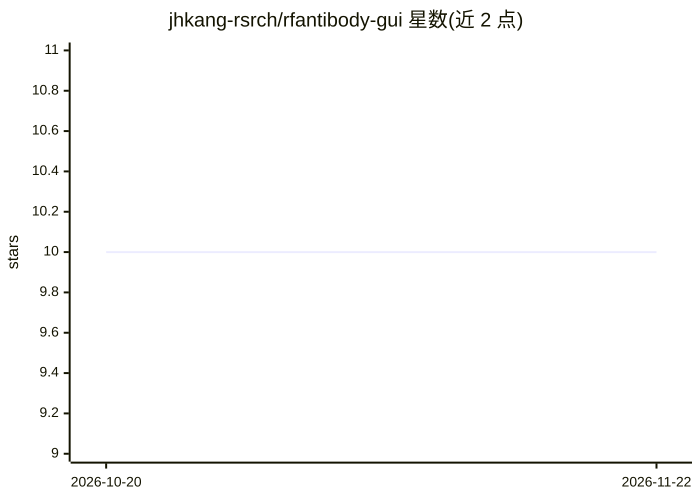

# jhkang-rsrch/rfantibody-gui

⭐ 10 · TypeScript · NOASSERTION · 推送 2025-12-02 · [GitHub](https://github.com/jhkang-rsrch/rfantibody-gui) · [官网](https://uos-nlp.notion.site/) · 个人维护

**为结构生物学研究者提供 RFantibody 抗体设计与 AF3 预测的 Web 图形界面**

面向 RFantibody 与 AlphaFold3 命令行流程封装的 Web 图形界面，通过 Docker Compose 编排 RFantibody 与 alphafold3 两个第三方子模块，在浏览器（localhost:2239）中提交任务并查看结果可视化与分析。要求单卡 24 GB 以上 VRAM、64 GB 内存、800 GB 磁盘。AlphaFold3 参数需向 Google DeepMind 单独申请获取，主体本身不含模型权重。

## 筛选速览

| 维度 | 判定 | 备注 |
|---|---|---|
| AI 角色 | `ai-native` | 本体是模型或模型工具 |
| 许可风险 | `none` | NOASSERTION |
| 部署形态 | `self-host` | docker 或自建部署 |
| 模型依赖 | — | README 未给出锁定关系 |
| 硬件要求 | `gpu-24g` | |
| 安装摩擦 | `low` | 无编译、无系统依赖或容器化 |
| 成熟度 | — | 结构信号不足 |

## 能力要点

- Web 界面访问 RFantibody 与 AlphaFold3 流程
- Docker Compose 一键启动，浏览器访问 localhost:2239
- 内置结果可视化与分析工具
- 以 git 子模块方式集成 RFantibody 与 alphafold3

## 适用场景

- 在本地 GPU 服务器上通过网页界面运行抗体设计流程
- 用 AlphaFold3 对设计结果做结构预测并可视化查看
- 为不熟悉命令行的团队成员提供图形化入口

## 场景标签

 · 领域:计算生物学/蛋白质结构

## 证据(README 行号)

> L6: A user-friendly graphical interface for RFantibody. This web-based GUI makes it easy to access and utilize the power
> L9: - 🖥️ Intuitive Web Interface
> L41: bash include/download_weights.sh

## 星数曲线

2026-10-20 10 → 2026-11-22 10（+0）

---
*卡片 v1 · prompt 1.4 · 生成 2026-11-19 · 置信度 high · 依据 README sha `74999df391cc` · [字段定义](../../DATASET.md)*
