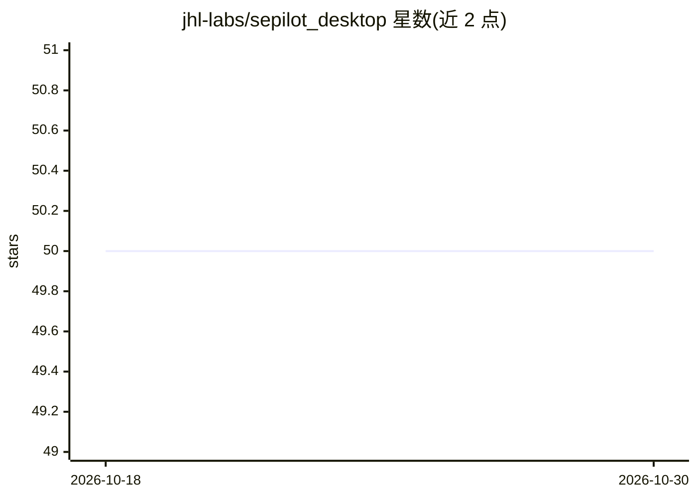

# jhl-labs/sepilot_desktop

⭐ 50 · TypeScript · NOASSERTION · 推送 2026-10-28 · [GitHub](https://github.com/jhl-labs/sepilot_desktop) · [官网](https://jhl-labs.github.io/sepilot_desktop/) · 组织维护

**本地 AI 代理 Sepilot 的桌面客户端应用**

Sepilot Desktop 是本地优先 AI 代理 Sepilot 的桌面应用，基于 Electron（主进程）+ Next.js 渲染层构建，启动后通过 HTTP 和 WebSocket 与本地 sepilotd 守护进程通信；守护进程与共享客户端库来自 git 子模块 jhl-labs/sepilot-cli。仓库声明为 source-available 而非开源。构建需 Node.js 22.18+、pnpm 10 与 git，Windows 打包额外需要 Rust 工具链；可打包为 Linux AppImage/deb、macOS zip 与 Windows 单文件 exe。

## 筛选速览

| 维度 | 判定 | 备注 |
|---|---|---|
| AI 角色 | `ai-native` | 本体是模型或模型工具 |
| 许可风险 | `none` | NOASSERTION |
| 部署形态 | `library` | 以包/库形式分发 |
| 模型依赖 | — | README 未给出锁定关系 |
| 硬件要求 | — | 无带数字的原话,不猜 |
| 安装摩擦 | `medium` | 含编译或系统依赖之一 |
| 成熟度 | — | 结构信号不足 |

## 能力要点

- Electron + Next.js 桌面应用，通过 HTTP/WebSocket 连接本地 sepilotd 守护进程
- 跨平台打包：Linux AppImage/deb、macOS zip（x64/arm64）、Windows 便携单文件 exe
- 守护进程与共享客户端库以 git 子模块（jhl-labs/sepilot-cli）提供
- 附带发布暂存、加固与产物校验脚本

## 适用场景

- 在桌面端使用本地优先的 Sepilot AI 代理
- 从源码构建并打包各平台安装产物
- 通过开发模式连接开发守护进程调试应用

## 场景标签

`AI 助手` · 领域:对话与助手

## 证据(README 行号)

> L3: Sepilot Desktop is the desktop app for Sepilot, a local-first AI agent. It
> L4: starts and talks to the local `sepilotd` daemon over HTTP and WebSocket.

## 星数曲线

2026-10-18 50 → 2026-10-30 50（+0）

---
*卡片 v1 · prompt 1.4 · 生成 2026-10-24 · 置信度 low · 依据 README sha `29e0b350f22b` · [字段定义](../../DATASET.md)*
