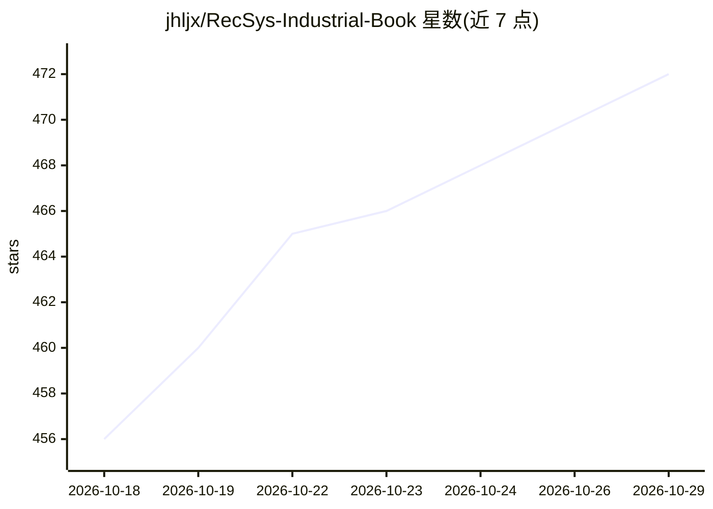

# jhljx/RecSys-Industrial-Book

⭐ 472 · Python · NOASSERTION · 推送 2026-10-21 · [GitHub](https://github.com/jhljx/RecSys-Industrial-Book) · [官网](https://jhljx.github.io/RecSys-Industrial-Book/) · 个人维护 · 中文 README

**推荐系统工业架构与算法的开源书稿及配套 AI 学习知识库**

《推荐系统：工业架构与核心算法》开源书稿仓库，面向具备机器学习/推荐基础的研究生、算法/架构/策略工程师。正文以发布 PDF 为唯一权威版本，上册约 80% 完稿、全册约 50%（约 650 页），覆盖架构、召回、粗排、精排、重排、生成式推荐等章节。仓库同时提供 AI Agent 知识库：对发布 PDF 本地建索引做混合检索并引用页码、12 周证据化学习课程、章节地图与概念卡、可安装到 Claude Code 等客户端的 Agent Skills、四个可运行工业推荐项目模板。不公开 LaTeX 或正文等价 Markdown，授权为个人学习非商用。

## 筛选速览

| 维度 | 判定 | 备注 |
|---|---|---|
| AI 角色 | `ai-knowledge` | 知识聚合/清单类 |
| 许可风险 | `none` | NOASSERTION |
| 部署形态 | `None` |  |
| 模型依赖 | — | README 未给出锁定关系 |
| 硬件要求 | — | 无带数字的原话,不猜 |
| 安装摩擦 | `low` | 无编译、无系统依赖或容器化 |
| 成熟度 | — | 结构信号不足 |

## 能力要点

- 对 19 章发布 PDF 本地建索引的混合检索，引用命中页码
- 12 周证据化学习课程，按提交物与测验分数验收掌握程度
- 可安装到 Claude Code 等兼容客户端的 Agent Skills（tools/install_skills.py）
- templates/ 提供多路召回、双塔 ANN 等四个可运行项目

## 适用场景

- 系统学习工业推荐系统全链路架构与核心算法
- 让 AI Agent 基于本书内容检索答疑并带我完成学习课程
- 通过可运行模板演练召回、粗排与在线服务等工程环节

## 场景标签

`推荐系统` `教程课程` `文档问答` · 领域:知识与检索

## 证据(README 行号)

> L9: **《推荐系统：工业架构与核心算法》开源书稿**
> L29: ## AI Agent：把电子书变成可执行的工业级推荐系统知识库
> L31: 发布 PDF 是唯一权威正文；`knowledge/` 提供独立撰写的章节地图、概念卡和前置图谱；`learning-paths/` 提供证据化课程；`.agents/skills/` 可安装到 Claude Code 等兼容客户

## 星数曲线

2026-10-18 456 → 2026-10-29 472（+16）

---
*卡片 v1 · prompt 1.4 · 生成 2026-10-21 · 置信度 high · 依据 README sha `e6e19995bc2c` · [字段定义](../../DATASET.md)*
