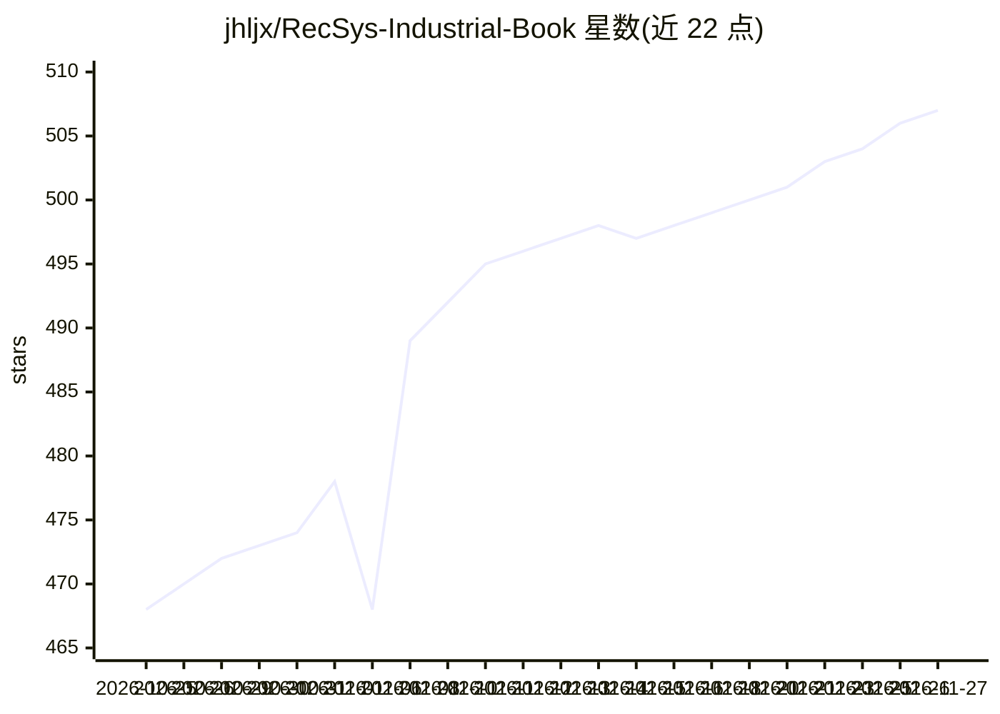

# jhljx/RecSys-Industrial-Book

⭐ 507 · Python · NOASSERTION · 推送 2026-11-26 · [GitHub](https://github.com/jhljx/RecSys-Industrial-Book) · [官网](https://jhljx.github.io/RecSys-Industrial-Book/) · 个人维护 · 中文 README

**推荐系统工业书稿 + 本地 Agent 学习工作台，面向读者学习实践**

《推荐系统：工业架构与核心算法》开源书稿仓库：发布 22 份章节 PDF（897 页）作为唯一权威正文，覆盖召回、粗排、精排、重排、混排、生成式推荐等工业推荐全链路。配套本地优先 AI Agent（tools/recsys_agent.py）：对本地 PDF 建立检索索引，提供页码引用问答、12 周课程学习、复习评估、代码讲解与可运行练习项目；知识地图含 197 张概念卡与 209 条前置依赖。技能可安装到 Claude Code 等兼容客户端；索引与个人进度保存在本机，无需 MCP 或云端知识库。授权为个人学习非商用。

## 筛选速览

| 维度 | 判定 | 备注 |
|---|---|---|
| AI 角色 | `ai-knowledge` | 知识聚合/清单类 |
| 许可风险 | `none` | NOASSERTION |
| 部署形态 | `None` |  |
| 模型依赖 | — | README 未给出锁定关系 |
| 硬件要求 | — | 无带数字的原话,不猜 |
| 安装摩擦 | `low` | 无编译、无系统依赖或容器化 |
| 成熟度 | — | 结构信号不足 |

## 能力要点

- 22 份章节 PDF（897 页）覆盖工业推荐系统全链路架构与算法
- 本地 Agent 提供 ask/search/coach/course/debug 等学习与实践命令，带 PDF 页码引用
- 知识地图汇总 22 章、197 张概念卡、209 条前置依赖与 122 个论文方法
- Agent Skills 可安装到 Claude Code 等兼容客户端

## 适用场景

- 系统学习工业推荐系统的召回、粗排、精排等模块
- 按 12 周课程路线完成学习任务并证据化验收
- 向本地 Agent 提问书稿内容并获取页码依据
- 通过可运行项目演练双塔召回、特征一致性等工程问题

## 场景标签

`教程课程` · 领域:学习与行业

## 证据(README 行号)

> L14: 把已发布章节 PDF 作为权威知识源，通过本地优先的 AI Agent 将书稿连接到检索引用、课程学习、复习评估和可运行的推荐系统实践。知识地图帮助定位内容，Agent 帮助读者把内容学会、用起来。
> L16: > 面向具备机器学习或推荐基础的研究生、推荐/算法工程师、架构师和技术研究者。零基础读者建议先补机器学习与深度学习基础。书稿和主要学习资料以中文为主。
> L26: **AI Agent**：直接基于发布 PDF 建立本地检索索引，提供页码引用、学习路径、练习与工程工作流；无需 MCP 或云端知识库，索引和个人进度保存在本机。

## 星数曲线

2026-10-25 468 → 2026-11-27 507（+39）

---
*卡片 v1 · prompt 1.4 · 生成 2026-11-25 · 置信度 high · 依据 README sha `e317eeaedff0` · [字段定义](../../DATASET.md)*
