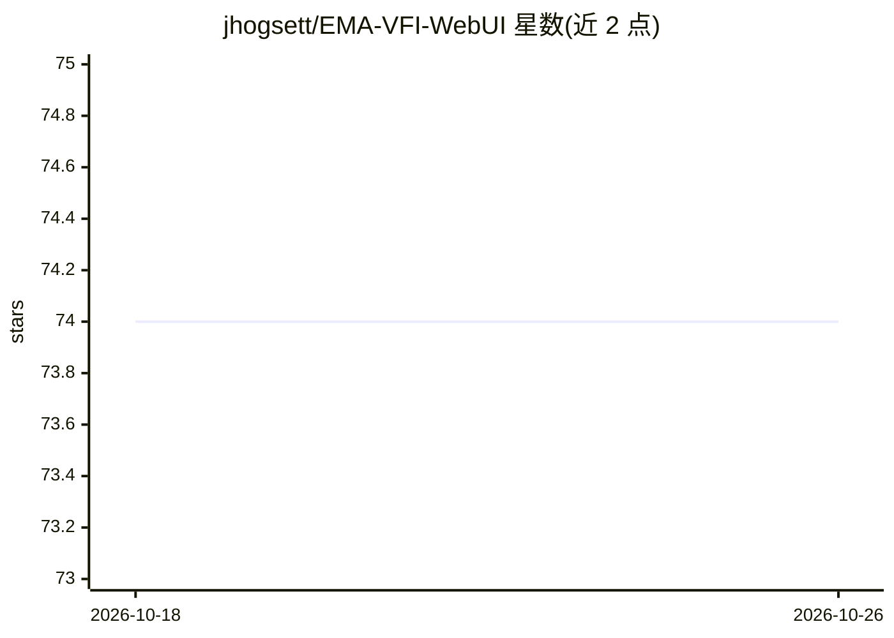

# jhogsett/EMA-VFI-WebUI

⭐ 74 · Python · MIT · 推送 2026-05-25 · [GitHub](https://github.com/jhogsett/EMA-VFI-WebUI) · 个人维护

**EMA-VFI 帧插值/修复的 Gradio Web 界面，配 Real-ESRGAN 放大**

为 EMA-VFI 视频帧插值模型提供的 Gradio Web UI：功能包括帧插值补帧、精确时刻帧合成、超慢动作、整段视频重合成、相邻损坏帧修复、PNG 序列与视频互转、改 FPS、GIF 转 MP4，并调用 Real-ESRGAN 做帧放大清理。面向已有可运行的 EMA-VFI 环境的用户：克隆本仓库并覆盖到既有安装目录，通过 webui.bat 或 python webui.py 启动，部分功能依赖系统 FFmpeg；核心功能另有命令行等价工具。

## 筛选速览

| 维度 | 判定 | 备注 |
|---|---|---|
| AI 角色 | `ai-native` | 本体是模型或模型工具 |
| 许可风险 | `permissive` | MIT |
| 部署形态 | `None` |  |
| 模型依赖 | — | README 未给出锁定关系 |
| 硬件要求 | — | 无带数字的原话,不猜 |
| 安装摩擦 | `medium` | 含编译或系统依赖之一 |
| 成熟度 | — | 结构信号不足 |

## 能力要点

- 12 项功能：补帧、帧合成、超慢动作、视频重合成、帧修复、格式转换等
- 用 Real-ESRGAN（4x+ 模型自动下载）做帧放大与清理
- 提供 Web UI 与对应的命令行工具，配置文件可指定（config.yaml）

## 适用场景

- 修复 8MM 老胶片等带噪点损伤的视频素材
- 把 GIF 或低帧率视频插帧为高帧率 MP4
- 生成超慢动作视频或合成指定时刻的帧

## 场景标签

`图像视频处理` · 领域:感知与多模态

## 证据(README 行号)

> L7: # EMA-VFI-WebUI - AI-Based Movie Restoration
> L33: |**➗ Frame Interpolation**|_Restore Missing Frames, Reveal Hidden Motion_|
> L43: |**📈 Upscale Frames**|_Use_ Real-ESRGAN _to Enlarge and Clean Frames_|

## 星数曲线

2026-10-18 74 → 2026-10-26 74（+0）

---
*卡片 v1 · prompt 1.4 · 生成 2026-10-24 · 置信度 high · 依据 README sha `11e80513e882` · [字段定义](../../DATASET.md)*
