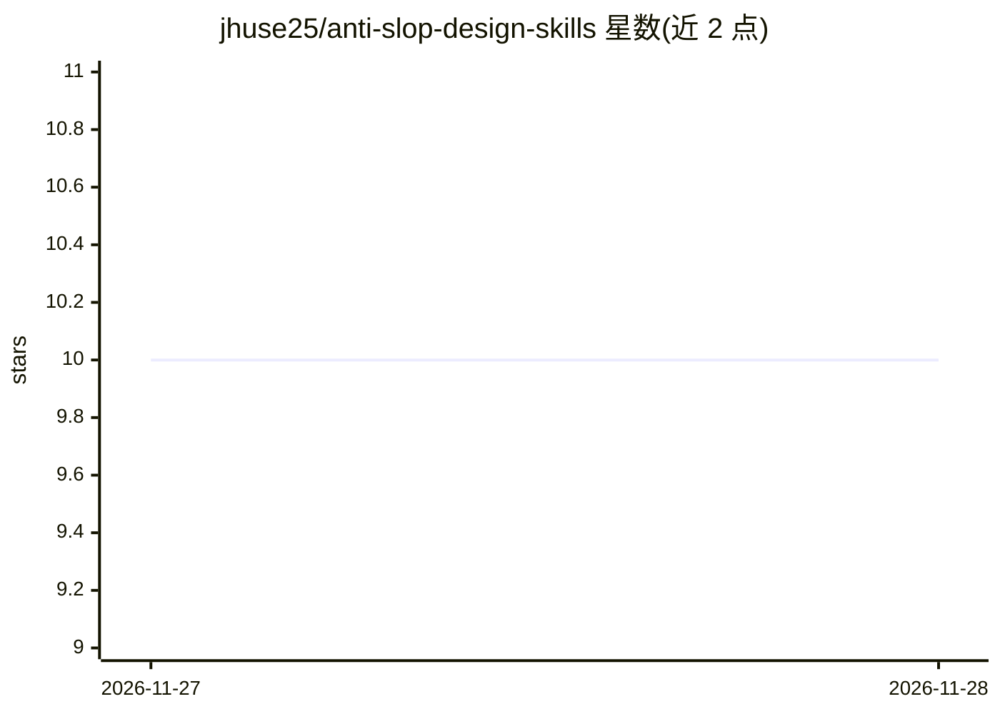

# jhuse25/anti-slop-design-skills

⭐ 10 · PowerShell · MIT · 推送 2026-08-23 · [GitHub](https://github.com/jhuse25/anti-slop-design-skills) · 个人维护

**供 AI 编码工具使用的反 AI 味设计技能与 agent 包**

一套以 SKILL.md 形式分发的提示词规则包，包含三个技能（Web UI、演示文稿、文档）与两个端到端构建 agent，用于在生成界面、幻灯片和文档时执行设计约束：禁用常见模板化样式、设置 VARIANCE/MOTION/DENSITY 参数、要求单一签名元素，并以检查清单作为交付门槛。以 Claude Code 插件安装，或复制到 ~/.claude/，也可将 SKILL.md 作为上下文加载到 Cursor、Copilot 等其他工具或原始 LLM。不含主题或组件库。

## 筛选速览

| 维度 | 判定 | 备注 |
|---|---|---|
| AI 角色 | `ai-knowledge` | 知识聚合/清单类 |
| 许可风险 | `permissive` | MIT |
| 部署形态 | `None` |  |
| 模型依赖 | — | README 未给出锁定关系 |
| 硬件要求 | — | 无带数字的原话,不猜 |
| 安装摩擦 | `low` | 无编译、无系统依赖或容器化 |
| 成熟度 | — | 结构信号不足 |

## 能力要点

- 三个技能覆盖 Web UI、pptx/Slides、docx/PDF 三类媒介
- 两个 agent 可端到端构建真实演示文稿与文档
- 以 pre-flight 检查清单作为交付门槛（未豁免失败即不可发布）
- 多媒介项目共享同一 DESIGN.md 设计系统

## 适用场景

- 用 Claude Code 生成不呈模板化样式的界面与幻灯片
- 为多媒介项目建立统一的设计规范文档
- 在 Cursor 等其他 AI 编码工具中加载设计规则

## 场景标签

`提示工程` · 领域:Agent 开发

## 证据(README 行号)

> L10: It ships as three **skills** and two **agents**:
> L61: Cursor, Windsurf, Copilot, a raw LLM or the API — the skills are plain `SKILL.md` files you load as

## 星数曲线

2026-11-27 10 → 2026-11-28 10（+0）

---
*卡片 v1 · prompt 1.4 · 生成 2026-11-27 · 置信度 high · 依据 README sha `bad0e319ce2c` · [字段定义](../../DATASET.md)*
