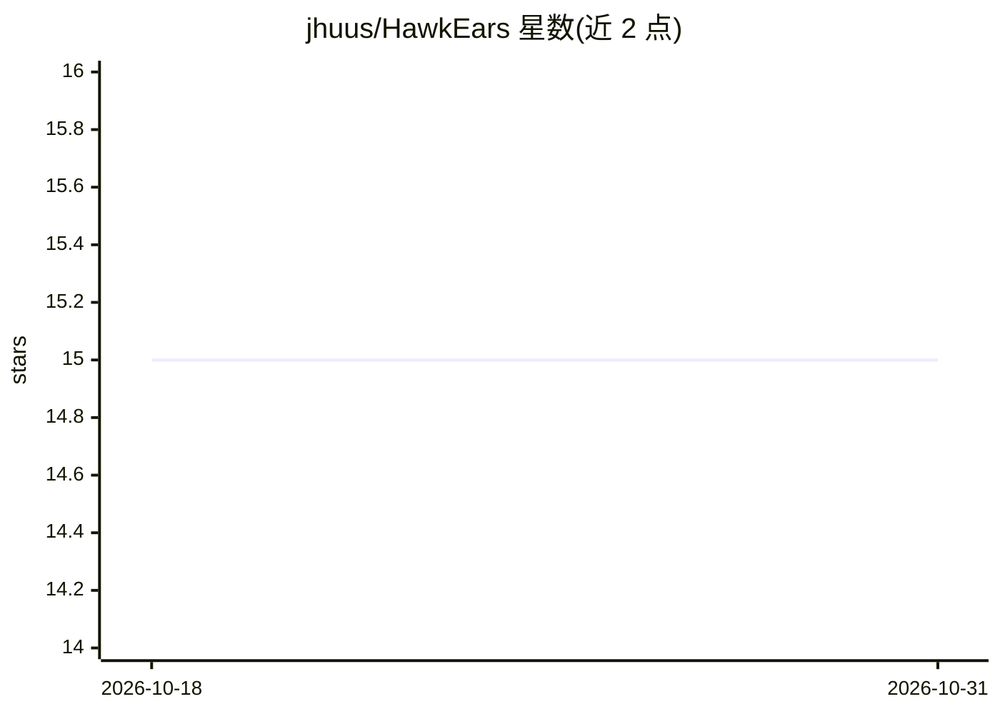

# jhuus/HawkEars

⭐ 15 · Python · MIT · 推送 2026-10-30 · [GitHub](https://github.com/jhuus/HawkEars) · 个人维护

**音频鸟类与两栖类声音识别的桌面/CLI 分析工具**

基于深度学习模型的声音事件检测应用，识别加拿大及美国北部 381 种鸟类和 15 种两栖类。提供 GUI、CLI 和 Python API 三种接口：GUI 支持项目管理、声谱图复核、标注修正与报告导出；CLI 支持批量分析与脚本化流程。分析采用最多 6 个模型的集成，可按位置和日期过滤稀有物种并校正相似物种识别。支持 CUDA GPU、Apple Metal 与 CPU（可选 OpenVINO）推理，模型限定于北美区域物种。

## 筛选速览

| 维度 | 判定 | 备注 |
|---|---|---|
| AI 角色 | `ai-native` | 本体是模型或模型工具 |
| 许可风险 | `permissive` | MIT |
| 部署形态 | `library` | 以包/库形式分发 |
| 模型依赖 | — | README 未给出锁定关系 |
| 硬件要求 | — | 无带数字的原话,不猜 |
| 安装摩擦 | `medium` | 含编译或系统依赖之一 |
| 成熟度 | — | 结构信号不足 |

## 能力要点

- 识别 381 种鸟类与 15 种两栖类（加拿大及美国北部）
- 最多 6 模型集成的神经网络推理，输出置信度标签
- 按位置/日期过滤稀有物种并校正相似物种（如东/西扑翅䴕）
- 支持 Audacity/Raven/CSV 三种输出格式与标签复核工作流

## 适用场景

- 批量扫描野外录音并导出物种检测标签
- 在 GUI 中用声谱图和音频回放复核检测结果
- 将鸟类声学分析集成到自己的 Python 程序中

## 场景标签

 · 领域:生态学/生物声学

## 证据(README 行号)

> L4: HawkEars is a desktop application for detecting bird and amphibian sounds in audio recordings and reviewing the resu
> L18: @article{HUUS2025103122,

## 星数曲线

2026-10-18 15 → 2026-10-31 15（+0）

---
*卡片 v1 · prompt 1.4 · 生成 2026-10-30 · 置信度 high · 依据 README sha `7589fd56c0dd` · [字段定义](../../DATASET.md)*
