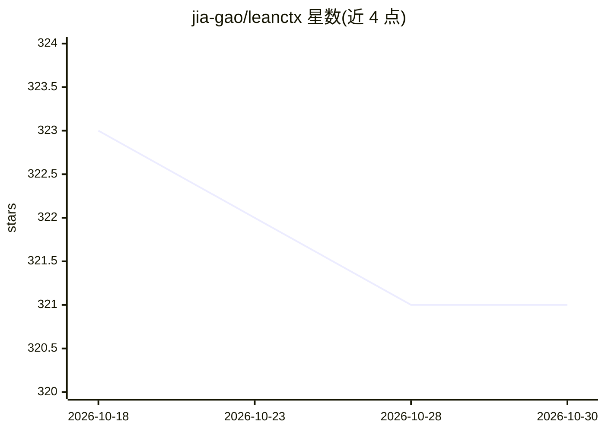

# jia-gao/leanctx

⭐ 321 · Python · MIT · 推送 2026-08-22 · [GitHub](https://github.com/jia-gao/leanctx) · 个人维护

**生产级 LLM 应用的 prompt 压缩 SDK：不改代码削减输入 token**

以 Python SDK 形式提供的 drop-in prompt 压缩层：通过同名类替换（如 from leanctx import OpenAI）保持原接口，对请求内容按失真容忍度分级路由——代码、堆栈、tool_use 等逐字保留，文档、检索片段、历史对话用本地 LLMLingua-2 压缩，低置信文本可选 SelfLLM 压缩。面向 RAG、长对话 agent、文档处理与编码 agent 等场景，LongBench v2 全集（N=503）测得额外削减 18.7% token、精度下降 1.8pp，逐条记录提交在仓库内可复现。默认数据不出本地，集成 fail-open：压缩失败时原请求直通。首次使用 Lingua 需下载约 1.2GB 模型权重，无该可选依赖时退化为直通。

## 筛选速览

| 维度 | 判定 | 备注 |
|---|---|---|
| AI 角色 | `ai-ecosystem` | LLM/agent 周边工具 |
| 许可风险 | `permissive` | MIT |
| 部署形态 | `self-host` | docker 或自建部署 |
| 模型依赖 | locked-api |  |
| 硬件要求 | — | 无带数字的原话,不猜 |
| 安装摩擦 | `low` | 无编译、无系统依赖或容器化 |
| 成熟度 | — | 结构信号不足 |

## 能力要点

- 同名类替换实现 drop-in 接入，无需改动现有代码
- 按失真容忍度分级路由：零容忍内容逐字保留，高容忍内容本地 LLMLingua-2 压缩
- LongBench v2 N=503 全量评测，逐条记录随仓库提交、可复现
- 集成 fail-open 设计，压缩故障只损失节省不损失可用性

## 适用场景

- 降低 RAG 或长对话 agent 的输入 token 开销
- 控制编码 agent 不断增长的工具调用历史成本
- 在数据不出本地的前提下压缩发送给 LLM 提供商的上下文

## 场景标签

`提示工程` · 领域:Agent 开发

## 证据(README 行号)

> L15: from leanctx import OpenAI  # same interface, compressed requests
> L18: On the full **LongBench v2** set (N=503), layered on top of a compressor that is already running, leanctx removes *
> L47: pip install 'leanctx[openai,lingua]'    # or [anthropic], [gemini]

## 星数曲线

2026-10-18 323 → 2026-10-30 321（-2）

---
*卡片 v1 · prompt 1.4 · 生成 2026-10-21 · 置信度 high · 依据 README sha `51eb8c9a30e9` · [字段定义](../../DATASET.md)*
