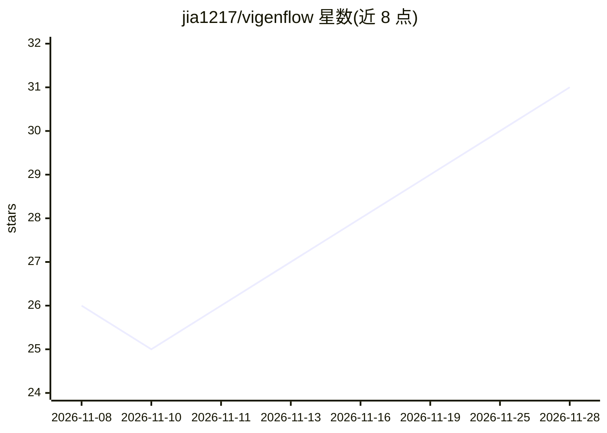

# jia1217/vigenflow

⭐ 31 · C++ · Apache-2.0 · 推送 2026-11-23 · [GitHub](https://github.com/jia1217/vigenflow) · 个人维护

**在 AMD Ryzen AI NPU 上本地运行扩散模型生图的工具**

面向 AMD Ryzen AI 300 系列（XDNA 2 NPU）用户的本地图像生成与编辑工具：内置浏览器 Web UI，支持 7 个扩散模型（FLUX.1-schnell、FLUX.2-klein-4B、Krea 2 Turbo、Z-Image-Turbo、Qwen Image 2.1 Turbo 等），提供 LoRA 风格、16–2048 像素自定义尺寸与图像编辑（前后对比滑块）。推理全部在 CPU + NPU 上本地完成，无需 Python、Docker 或额外前端，可选用 OpenWebUI 接入（OpenAI 兼容 API /v1）。限制：仅限指定 NPU 硬件与 Windows/Ubuntu 系统，Krea 2 与 Qwen 权重有商用限制。

## 筛选速览

| 维度 | 判定 | 备注 |
|---|---|---|
| AI 角色 | `ai-native` | 本体是模型或模型工具 |
| 许可风险 | `permissive` | Apache-2.0 |
| 部署形态 | `desktop` | 安装包/桌面程序 |
| 模型依赖 | — | README 未给出锁定关系 |
| 硬件要求 | — | 无带数字的原话,不猜 |
| 安装摩擦 | `low` | 无编译、无系统依赖或容器化 |
| 成熟度 | `idea` | |

## 能力要点

- 7 个文生图/图生图模型全在 AMD NPU 上本地推理
- 内置浏览器 Web UI，无需 Python、Docker 或额外前端
- LoRA 风格选择与 16–2048 像素自定义图像尺寸
- OpenAI 兼容 API（/v1），可选接入 OpenWebUI

## 适用场景

- 在搭载 Ryzen AI NPU 的电脑上本地生成和编辑图片
- 通过浏览器 Web UI 选择模型、风格与尺寸出图
- 用 OpenWebUI 前端调用本地 NPU 生图服务

## 场景标签

`图像生成` · 领域:内容生成

## 证据(README 行号)

> L3: **Create images locally with AMD NPU acceleration and a built-in browser UI.**
> L5: **v0.2.0 Beta 4** adds a **built-in web UI**: generate and edit images with all seven models from your browser, on *
> L97: All models use BFP16 weights and make images from 16 to 2048 pixels per side, in multiples of 16. The two editing m

## 星数曲线

2026-11-08 26 → 2026-11-28 31（+5）

---
*卡片 v1 · prompt 1.4 · 生成 2026-11-18 · 置信度 high · 依据 README sha `fae1d7d01b8f` · [字段定义](../../DATASET.md)*
