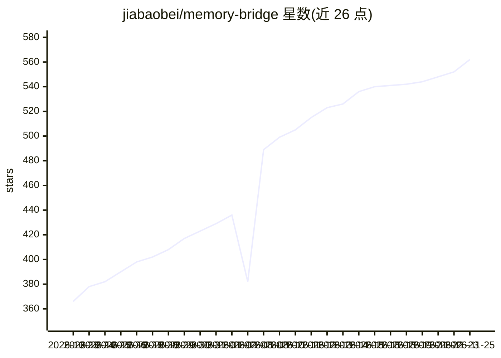

# jiabaobei/memory-bridge

⭐ 562 · Python · MIT · 推送 2026-11-23 · [GitHub](https://github.com/jiabaobei/memory-bridge) · 个人维护 · 中文 README

**跨设备跨平台共享的 AI 记忆层，供 MCP 客户端使用**

CDSMP 架构的工程实现：通过网盘同步端到端加密差分包，让手机/PC/平板共享同一份语义记忆；核心零依赖 Python 实现，含三路混合检索（向量+关键词+图谱）、热度预加载、交接卡工作台与 PAMS 隐私分级。通过 MCP 协议接入 Claude Code、Cursor 等客户端，支持网关基站模式供手机 HTTP 读写；架构坚持内容冻结原则，不使用 LLM 改写记忆。

## 筛选速览

| 维度 | 判定 | 备注 |
|---|---|---|
| AI 角色 | `ai-ecosystem` | LLM/agent 周边工具 |
| 许可风险 | `permissive` | MIT |
| 部署形态 | `desktop` | 安装包/桌面程序 |
| 模型依赖 | — | README 未给出锁定关系 |
| 硬件要求 | — | 无带数字的原话,不猜 |
| 安装摩擦 | `low` | 无编译、无系统依赖或容器化 |
| 成熟度 | `idea` | |

## 能力要点

- MCP Server 模式，任意 MCP 客户端即插即用，--http 供 Coze 等平台远程接入
- 跨设备增量差分同步（DSS），经百度网盘/坚果云/OneDrive 中转，端到端加密
- 三路混合检索 + RRF 融合，Path A 记忆注入受 token 预算约束
- 网关基站模式：旧手机可作低功耗基站，手机/平板经 HTTP 读写记忆库

## 适用场景

- 在手机上和 AI 讨论到一半的推理，回到 PC 继续而不重新解释背景
- 让 Claude Code、Cursor 等多个 MCP 客户端共享同一份记忆库
- 用旧手机搭本地模型加记忆网关组成零云端个人 AI 栈

## 场景标签

`Agent 记忆` · 领域:Agent 开发

## 证据(README 行号)

> L26: 同时，记忆桥是**跨平台**的：通过 MCP 协议，同一个记忆库可以被 Claude Code、Cursor、Cline 等任意 MCP 客户端共享使用（平台覆盖详情见下文矩阵）。
> L75: |MCP Server|任意 MCP 客户端即插即用；`--http` 远程模式供扣子 Coze 等平台接入|✅ v0 已实现|

## 星数曲线

2026-10-23 366 → 2026-11-25 562（+196）

---
*卡片 v1 · prompt 1.4 · 生成 2026-11-25 · 置信度 mid · 依据 README sha `6165ae46bf80` · [字段定义](../../DATASET.md)*
