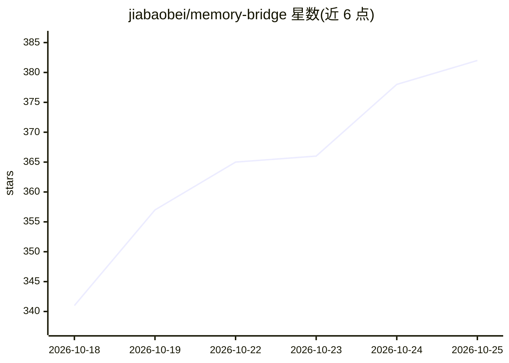

# jiabaobei/memory-bridge

⭐ 382 · Python · MIT · 推送 2026-10-18 · [GitHub](https://github.com/jiabaobei/memory-bridge) · 个人维护 · 中文 README

**跨设备共享的 AI 语义记忆层：记忆跟人走而非跟 App 走**

CDSMP 架构的官方工程实现：为 AI 提供跨手机/PC/平板的共享语义记忆库。通过网盘（坚果云/OneDrive/百度网盘）中转端到端加密的差分包做增量同步，无服务器、无账号；支持边缘预加载、三路混合检索（向量+关键词+图谱 RRF 融合）、交接卡工作台与内容冻结原则（不改写原始记忆）。以 MCP Server 接入 Claude Code、Cursor、Cline 等客户端，网关基站模式供手机浏览器访问。核心零依赖，从 Git 源码安装（未发布 PyPI，membridge 包名为抢注）。

## 筛选速览

| 维度 | 判定 | 备注 |
|---|---|---|
| AI 角色 | `ai-ecosystem` | LLM/agent 周边工具 |
| 许可风险 | `permissive` | MIT |
| 部署形态 | `desktop` | 安装包/桌面程序 |
| 模型依赖 | — | README 未给出锁定关系 |
| 硬件要求 | — | 无带数字的原话,不猜 |
| 安装摩擦 | `low` | 无编译、无系统依赖或容器化 |
| 成熟度 | — | 结构信号不足 |

## 能力要点

- 端到端加密差分包经网盘中转实现跨设备同步，网盘只见密文
- MCP Server 接入主流 AI 客户端，init 自动检测配置
- 三路混合检索 + RRF 融合与 token 预算注入
- PAMS 隐私门控（local 节点不离开设备）与 Markdown 只读导出

## 适用场景

- 在手机上讨论到一半的任务回到 PC 继续且保留上下文
- 让多个 AI 客户端（Claude Code/Cursor/Cline）共享同一份记忆库
- 切换设备前预加载高热度记忆，实现零等待衔接
- 旧手机跑网关基站，为移动端提供 HTTP 记忆读写

## 场景标签

`Agent 记忆` · 领域:Agent 开发

## 证据(README 行号)

> L5: > CDSMP（大模型跨设备语义记忆连续性架构）的官方工程实现。
> L26: 同时，记忆桥是**跨平台**的：通过 MCP 协议，同一个记忆库可以被 Claude Code、Cursor、Cline 等任意 MCP 客户端共享使用（平台覆盖详情见下文矩阵）。
> L73: |MCP Server|任意 MCP 客户端即插即用；`--http` 远程模式供扣子 Coze 等平台接入|✅ v0 已实现|

## 星数曲线

2026-10-18 341 → 2026-10-25 382（+41）

---
*卡片 v1 · prompt 1.4 · 生成 2026-10-21 · 置信度 mid · 依据 README sha `e85e3327068d` · [字段定义](../../DATASET.md)*
