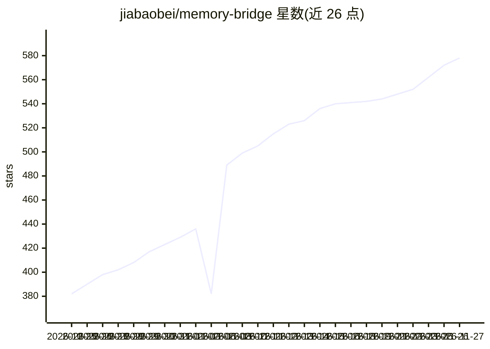

# jiabaobei/memory-bridge

⭐ 578 · Python · MIT · 推送 2026-11-24 · [GitHub](https://github.com/jiabaobei/memory-bridge) · 个人维护 · 中文 README

**给 AI 助手提供跨设备共享记忆层的 MCP 服务**

基于 CDSMP 架构的 AI 共享记忆层：以 SQLite 存储记忆条目、语义向量与关联边，通过网盘同步加密差分包实现手机/PC/平板间的记忆连续性，支持边缘预加载与内容冻结（不改写原始记忆）。经 MCP 协议接入 Claude Code、Cursor、Cline 等客户端，并支持网关基站模式供手机浏览器读写。核心零依赖、纯标准库实现，检索为向量+关键词+图谱三路混合，写入依赖用户显式提交而非 LLM 自动蒸馏。

## 筛选速览

| 维度 | 判定 | 备注 |
|---|---|---|
| AI 角色 | `ai-ecosystem` | LLM/agent 周边工具 |
| 许可风险 | `permissive` | MIT |
| 部署形态 | `desktop` | 安装包/桌面程序 |
| 模型依赖 | — | README 未给出锁定关系 |
| 硬件要求 | — | 无带数字的原话,不猜 |
| 安装摩擦 | `low` | 无编译、无系统依赖或容器化 |
| 成熟度 | — | 结构信号不足 |

## 能力要点

- 跨设备增量差分同步（DSS），网盘只传输端到端加密包
- MCP Server 供任意 MCP 客户端接入，支持 HTTP 远程模式
- 向量+关键词+SAN 图谱三路混合检索与 RRF 融合
- 内容冻结原则：只提取语义关联，不改写原始记忆内容

## 适用场景

- 在手机上开始的 AI 对话上下文，回到 PC 继续使用
- 多个 MCP 客户端（Claude Code/Cursor/Cline）共享同一份记忆库
- 用旧手机搭建零云端的本地记忆+推理个人 AI 栈
- 需要记忆内容可审计、可导出为 Markdown 存档的场景

## 场景标签

`Agent 记忆` · 领域:Agent 开发

## 证据(README 行号)

> L26: 同时，记忆桥是**跨平台**的：通过 MCP 协议，同一个记忆库可以被 Claude Code、Cursor、Cline 等任意 MCP 客户端共享使用（平台覆盖详情见下文矩阵）。
> L75: |MCP Server|任意 MCP 客户端即插即用；`--http` 远程模式供扣子 Coze 等平台接入|✅ v0 已实现|
> L55: |三路混合检索 + RRF|向量 + 关键词（字面命中兜底）+ SAN 图谱一跳三路召回，按排名做 RRF 融合（k=60）——多路共识天然加分，无新参数可调|✅ v0.9|

## 星数曲线

2026-10-25 382 → 2026-11-27 578（+196）

---
*卡片 v1 · prompt 1.4 · 生成 2026-11-26 · 置信度 mid · 依据 README sha `1da8cf3a0ce8` · [字段定义](../../DATASET.md)*
