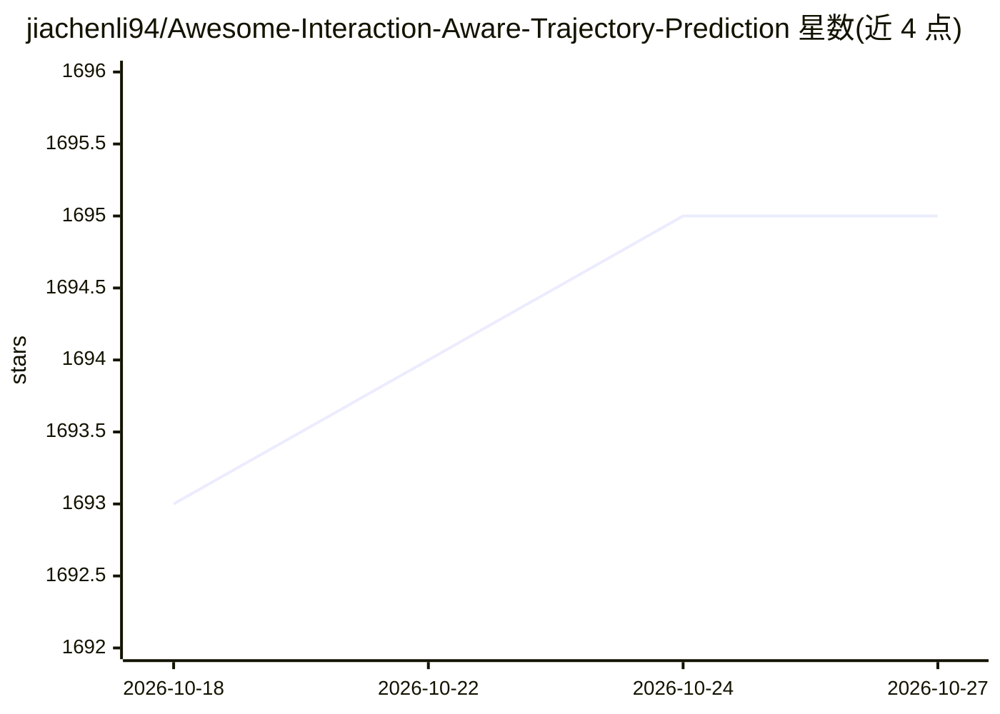

# jiachenli94/Awesome-Interaction-Aware-Trajectory-Prediction

⭐ 1,695 · TeX · MIT · 推送 2026-08-24 · [GitHub](https://github.com/jiachenli94/Awesome-Interaction-Aware-Trajectory-Prediction) · 组织维护

**交互感知轨迹预测研究资料清单（数据集/论文/代码）**

由 Stanford 与 UC Berkeley 研究者维护的轨迹预测领域 awesome 清单，收录三类资源：20+ 个车辆/行人/运动员轨迹数据集（含采集场景与传感器类型标注）、30+ 篇综述论文、以及物理系统交互建模、智能车辆与行人轨迹预测等方向的论文与开源代码条目，部分条目附论文链接与代码仓库。面向学术研究与工业界选型参考，持续更新中，接受 pull request 补充资源。

## 筛选速览

| 维度 | 判定 | 备注 |
|---|---|---|
| AI 角色 | `ai-knowledge` | 知识聚合/清单类 |
| 许可风险 | `permissive` | MIT |
| 部署形态 | `None` |  |
| 模型依赖 | — | README 未给出锁定关系 |
| 硬件要求 | — | 无带数字的原话,不猜 |
| 安装摩擦 | `low` | 无编译、无系统依赖或容器化 |
| 成熟度 | — | 结构信号不足 |

## 能力要点

- 按车辆交通、行人、运动员分类的数据集清单（含传感器与场景标注）
- 30+ 篇轨迹预测综述论文条目
- 覆盖物理系统交互建模与智能驾驶方向的论文与代码链接
- 维护者关联 EvolveGraph（NeurIPS 2020）等自身研究工作

## 适用场景

- 为轨迹预测研究查找公开数据集与基准
- 调研轨迹预测领域综述与最新方法论文
- 寻找有开源代码的轨迹预测方法进行复现或对比

## 场景标签

`精选清单` · 领域:学习与行业

## 证据(README 行号)

> L4: This is a checklist of state-of-the-art research materials (datasets, blogs, papers and public codes) related to tra
> L6: **Maintainers**: **Jiachen Li** (Stanford University); **Hengbo Ma**, **Jinning Li** (University of California, Berk

## 星数曲线

2026-10-18 1,693 → 2026-10-27 1,695（+2）

---
*卡片 v1 · prompt 1.4 · 生成 2026-10-21 · 置信度 high · 依据 README sha `772a720a4944` · [字段定义](../../DATASET.md)*
