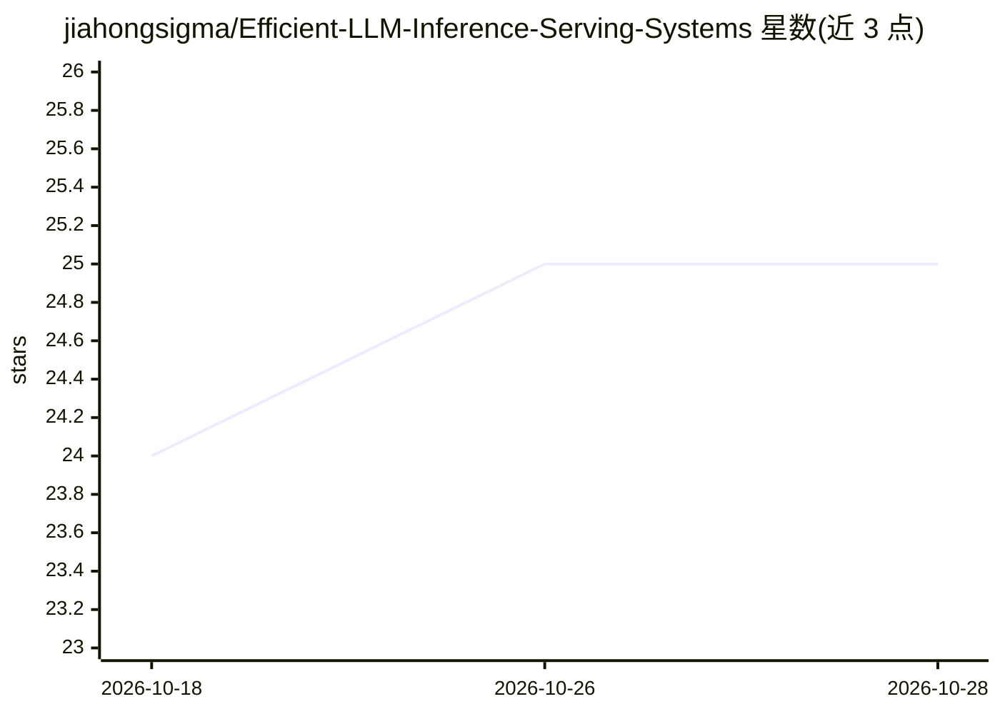

# jiahongsigma/Efficient-LLM-Inference-Serving-Systems

⭐ 25 · Python · MIT · 推送 2026-08-11 · [GitHub](https://github.com/jiahongsigma/Efficient-LLM-Inference-Serving-Systems) · 个人维护

**LLM 推理与服务的原理实践课程：roofline 到 vLLM/SGLang**

以第一性原理讲解 LLM 推理为何受内存带宽限制的动手课程：从 roofline 模型推导计算/访存瓶颈，依次覆盖 batching、KV cache 与 PagedAttention、量化、张量/流水线/专家并行、投机解码、结构化输出与评测方法，共 12+ 模块。每个模块配讲座推导、基于开源模型（Llama-3.1-8B、Qwen2.5 等）的 GPU 实验与文献阅读，实验大多可在单张 24–48GB GPU 上运行，另有无 GPU 的离线模拟器供开发调试。受众为希望自托管 LLM、具备 Python/Linux 与计算机体系结构基础的个人学习者。

## 筛选速览

| 维度 | 判定 | 备注 |
|---|---|---|
| AI 角色 | `ai-knowledge` | 知识聚合/清单类 |
| 许可风险 | `permissive` | MIT |
| 部署形态 | `None` |  |
| 模型依赖 | — | README 未给出锁定关系 |
| 硬件要求 | — | 无带数字的原话,不猜 |
| 安装摩擦 | `low` | 无编译、无系统依赖或容器化 |
| 成熟度 | — | 结构信号不足 |

## 能力要点

- 12+ 模块覆盖 batching/KV cache/量化/并行/投机解码/结构化输出/评测
- 实验基于开源模型，大多单张 24–48GB GPU 即可运行
- 共享 harness 通过 OpenAI 兼容 API 驱动真实引擎，开发期可用无 GPU 离线模拟器
- 主线与 Going Deeper 双层结构，重数学隔离在附录

## 适用场景

- 系统学习 LLM 推理优化的原理与动手实验
- 自托管 LLM 前掌握 vLLM/SGLang 的启动配置与基准测试
- 为推理性能问题建立 roofline 分析方法

## 场景标签

`教程课程` · 领域:学习与行业

## 证据(README 行号)

> L5: A hands-on, first-principles course on how LLMs are actually served in production — from the roofline up to vLLM & S
> L58: ## Learning outcomes

## 星数曲线

2026-10-18 24 → 2026-10-28 25（+1）

---
*卡片 v1 · prompt 1.4 · 生成 2026-10-27 · 置信度 high · 依据 README sha `8ae148d7ae45` · [字段定义](../../DATASET.md)*
