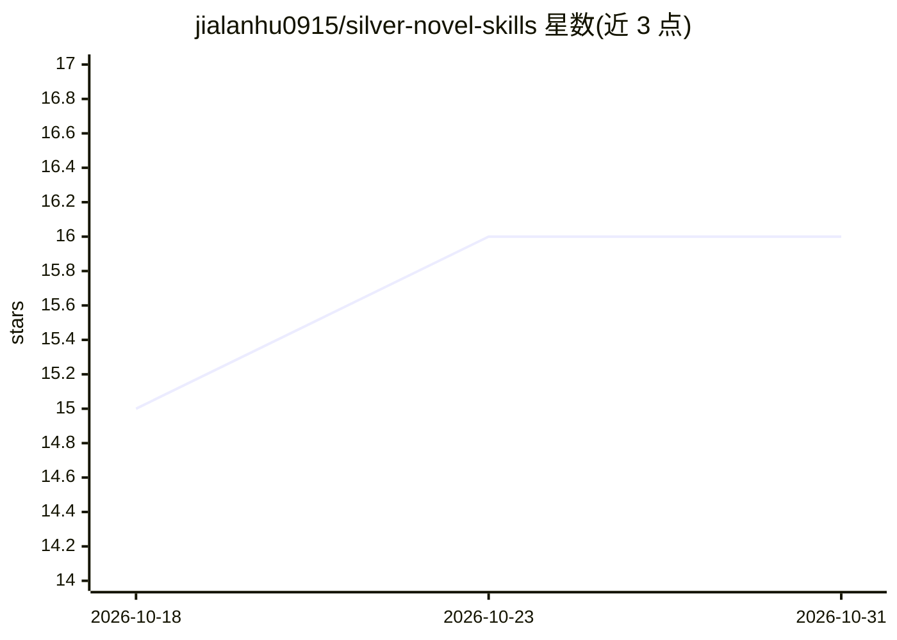

# jialanhu0915/silver-novel-skills

⭐ 16 · MIT · 推送 2026-07-07 · [GitHub](https://github.com/jialanhu0915/silver-novel-skills) · 个人维护 · 中文 README

**AI 小说写作技能集：男频/女频双系统创作与质量评测**

面向小说创作者的 AI 写作技能库，以 SKILL.md 为主入口，分男频/女频两套系统组织。男频覆盖玄幻、仙侠、都市等 13 类题材，女频覆盖言情、耽美、百合等 8 类。提供 WorldBuilder、CharacterCraft、PlotArchitect 三个框架构建 Agent 用于世界观、角色与情节设计，另有 12 个通用评测 Agent 与女频/男频专项评测 Agent（如男性角色独立性、感情线质量、宇宙恐怖专项）做多维度质量检查。使用方式为阅读 guide.md 后按流程调用各 Agent，MIT 许可证。

## 筛选速览

| 维度 | 判定 | 备注 |
|---|---|---|
| AI 角色 | `ai-knowledge` | 知识聚合/清单类 |
| 许可风险 | `permissive` | MIT |
| 部署形态 | `None` |  |
| 模型依赖 | — | README 未给出锁定关系 |
| 硬件要求 | — | 无带数字的原话,不猜 |
| 安装摩擦 | `low` | 无编译、无系统依赖或容器化 |
| 成熟度 | — | 结构信号不足 |

## 能力要点

- 男频/女频双系统，分别覆盖 13 类与 8 类题材
- WorldBuilder/CharacterCraft/PlotArchitect 三个框架构建 Agent
- 12 个通用评测 Agent 加男女频专项评测维度
- 金手指、反派智慧、爽点节奏、伏笔系统等设计理念

## 适用场景

- 用 AI agent 流程化构建小说世界观、角色与情节框架
- 创作后用多维度评测 Agent 检查逻辑一致性、节奏与伏笔
- 分别按男频或女频题材规范进行创作

## 场景标签

`AI 写作` `多智能体` · 领域:Agent 开发

## 证据(README 行号)

> L72: ├── SKILL.md              # 主入口
> L82: 1. 阅读 male/guide.md

## 星数曲线

2026-10-18 15 → 2026-10-31 16（+1）

---
*卡片 v1 · prompt 1.4 · 生成 2026-10-30 · 置信度 mid · 依据 README sha `fcffa65067b0` · [字段定义](../../DATASET.md)*
