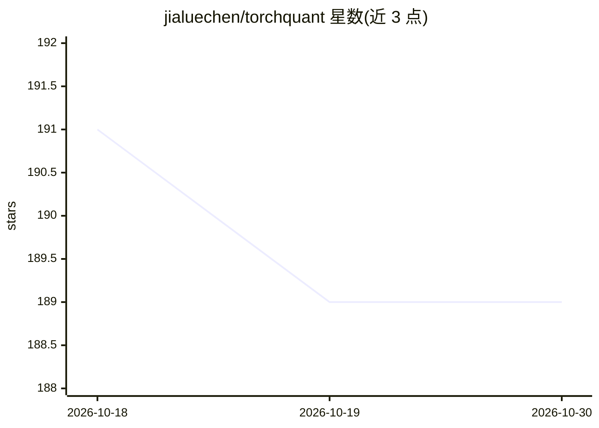

# jialuechen/torchquant

⭐ 189 · Python · Apache-2.0 · 推送 2025-12-16 · [GitHub](https://github.com/jialuechen/torchquant) · [官网](https://jialuechen.github.io/torchquant/) · 个人维护

**可微量化金融库：用深度学习机制定价衍生品与算风险**

基于 PyTorch 自动微分与 GPU 加速的量化金融 Python 库，覆盖欧式/美式/亚式/雪球等数十种期权与债券定价、Greeks 与 VaR/ES 风险度量、Heston/Vasicek/SABR 等随机模型的神经网络校准，以及 Seq2Seq PDE 求解器。核心做法是把各类奇异期权的收益结构映射为对应的神经网络组件（如 ReLU、门控 RNN、注意力池化），以降低计算复杂度，例如用 max pooling 将回望期权定价从 O(N*T) 降至 O(T/L+N)。通过 pip 以 torchquantlib 包名安装。

## 筛选速览

| 维度 | 判定 | 备注 |
|---|---|---|
| AI 角色 | `ai-native` | 本体是模型或模型工具 |
| 许可风险 | `permissive` | Apache-2.0 |
| 部署形态 | `library` | 以包/库形式分发 |
| 模型依赖 | — | README 未给出锁定关系 |
| 硬件要求 | — | 无带数字的原话,不猜 |
| 安装摩擦 | `low` | 无编译、无系统依赖或容器化 |
| 成熟度 | — | 结构信号不足 |

## 能力要点

- 奇异期权特征映射为神经网络组件的定价架构
- 基于 AAD 与 Malliavin 计算的 Greeks 及 VaR/ES 风险度量
- Heston/Vasicek/SABR 等随机模型的神经网络校准
- Seq2Seq PDE 求解器

## 适用场景

- 对奇异期权与结构化票据做可微定价
- 利用自动微分高效计算 Greeks 与市场风险指标
- 用神经网络方法校准随机波动率模型

## 场景标签

`金融量化` · 领域:学习与行业

## 证据(README 行号)

> L8: **TorchQuant** is a high-performance, differentiable quantitative finance library built on top of PyTorch's automati
> L50:  - Reducing computation costs for exotics options (a good example is the lookback option pricing that leverages max
> L58: - **Neural Network-based Model Calibration**:

## 星数曲线

2026-10-18 191 → 2026-10-30 189（-2）

---
*卡片 v1 · prompt 1.4 · 生成 2026-10-22 · 置信度 high · 依据 README sha `da54efd508ea` · [字段定义](../../DATASET.md)*
