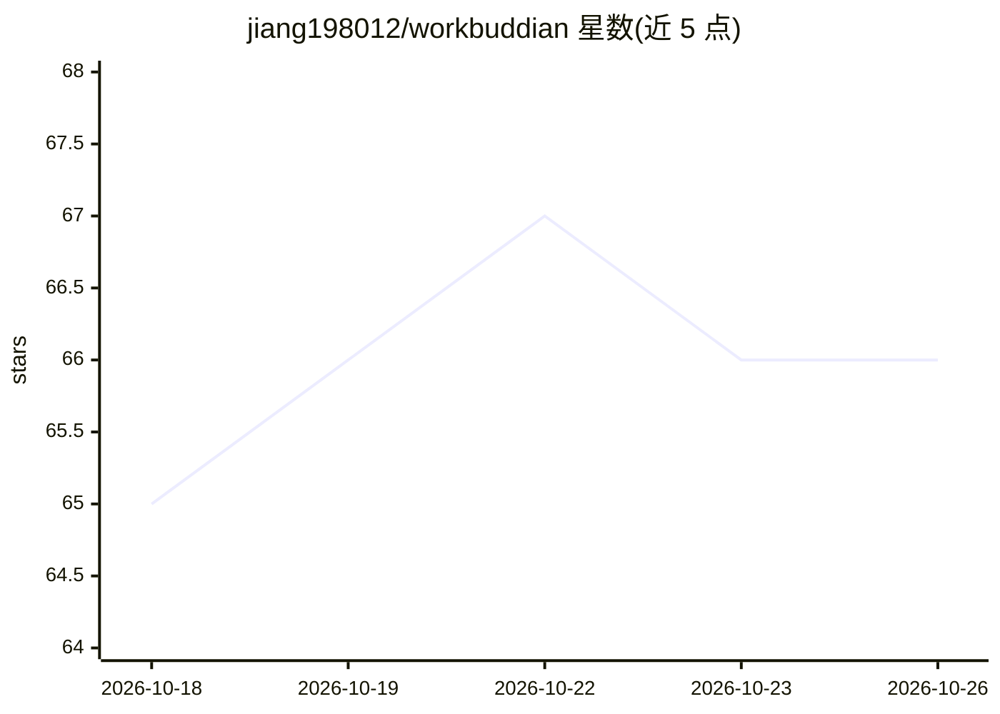

# jiang198012/workbuddian

⭐ 66 · TypeScript · MIT · 推送 2026-10-10 · [GitHub](https://github.com/jiang198012/workbuddian) · [官网](https://obsidian.md/plugins?id=workbuddian) · 个人维护 · 中文 README

**把 CodeBuddy CLI/Hermes agent 变成 Obsidian 内 AI 聊天的插件**

Obsidian 社区插件，将本地 CodeBuddy CLI（WorkBuddy 桌面版内置）或 Hermes agent 作为后端，在 Vault 内提供流式对话、`@` 引用（子代理/MCP/笔记/文件四源聚合）、图片分析、行级 diff 与一键撤销、气泡内批准卡、会话分叉与 MCP 可视化管理。依赖 WorkBuddy 桌面版（≥5.0.5）提供 CLI 与账号。仅支持 Windows/macOS 桌面端 Obsidian 1.7.2+，Linux 暂不支持；原生通路存在约 50 秒单次代理与 640 KiB 请求/响应限制，部分 Windows 场景未验收。

## 筛选速览

| 维度 | 判定 | 备注 |
|---|---|---|
| AI 角色 | `ai-ecosystem` | LLM/agent 周边工具 |
| 许可风险 | `permissive` | MIT |
| 部署形态 | `desktop` | 安装包/桌面程序 |
| 模型依赖 | — | README 未给出锁定关系 |
| 硬件要求 | — | 无带数字的原话,不猜 |
| 安装摩擦 | `low` | 无编译、无系统依赖或容器化 |
| 成熟度 | `idea` | |

## 能力要点

- 双后端：CodeBuddy CLI 与 Hermes agent 自由切换
- `@` 四源聚合引用（子代理/MCP/笔记/任意文件）
- Write/Edit/Bash/MCP 气泡内批准卡与行级 diff 一键撤销
- MCP 可视化管理、会话分叉、双面板独立会话

## 适用场景

- 在 Obsidian 笔记中直接与本地 CLI agent 对话并引用笔记内容
- 让 AI 读写 Vault 文件、查看 diff 并按需撤销编辑
- 管理 MCP 服务器与自定义子代理并在对话中调用

## 场景标签

`编码 Agent` `聊天机器人` · 领域:编码与开发

## 证据(README 行号)

> L12: **Workbuddian** 是一个 **Obsidian 社区插件**，把本地 **CodeBuddy CLI** 或 **Hermes agent** 变成你笔记里的 **AI 聊天助手**——不用切窗口，直接在 Vault
> L27: |**双后端**|本地 **CodeBuddy CLI**(完整能力)或 **Hermes agent**(gateway 纯对话)自由切换;Hermes 免配置自动发现,模型列表与 Desktop 一致|
> L258: - **CodeBuddy / WorkBuddy** — 本插件的后端 CLI,本地编程 agent。

## 星数曲线

2026-10-18 65 → 2026-10-26 66（+1）

---
*卡片 v1 · prompt 1.4 · 生成 2026-10-24 · 置信度 high · 依据 README sha `bea5ab8a44c5` · [字段定义](../../DATASET.md)*
