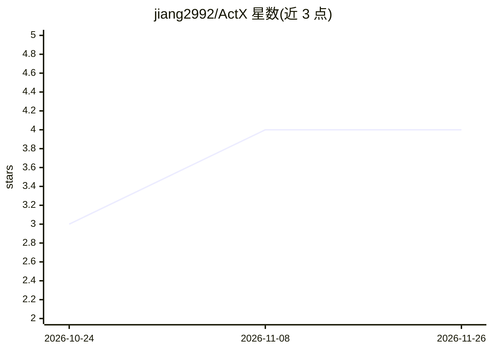

# jiang2992/ActX

⭐ 4 · Java · Apache-2.0 · 推送 2026-10-29 · [GitHub](https://github.com/jiang2992/ActX) · [官网](https://jiang2992.github.io/ActX/) · 个人维护 · 中文 README

**帮 Java 企业项目接入专属 AI 智能体的应用**

基于 Spring Boot 3.2 与 Spring AI 1.1 的 Java 通用业务智能体应用，以「轻量、扩展强、无侵入」方式让 Java 企业项目接入 AI Agent。内置 9 个核心 Agent 与多 Agent 协作、复杂任务分解执行链、对话记忆、MCP 工具接入、沙箱隔离代码执行；并支持通过业务数据库与文档自主构建知识图谱做数据查询，配三层语句安全检测与租户/权限控制。运行需 JDK 17+ 与 Maven，Neo4j 与 OpenSandbox 为可选组件，消息渠道可对接飞书、钉钉、微信等。

## 筛选速览

| 维度 | 判定 | 备注 |
|---|---|---|
| AI 角色 | `ai-ecosystem` | LLM/agent 周边工具 |
| 许可风险 | `permissive` | Apache-2.0 |
| 部署形态 | `self-host` | docker 或自建部署 |
| 模型依赖 | locked-api |  |
| 硬件要求 | — | 无带数字的原话,不猜 |
| 安装摩擦 | `low` | 无编译、无系统依赖或容器化 |
| 成熟度 | — | 结构信号不足 |

## 能力要点

- 多 Agent 协作：场景→Agent→模型三级管理，内置 9 个核心 Agent
- 复杂任务系统：评估→规划→派发→执行→审查→总结的完整流程
- 业务认知：从数据源与业务材料构建知识图谱并据此查询
- MCP 多模式工具接入与 OpenSandbox 沙箱隔离执行

## 适用场景

- 为现有 Java 企业系统快速接入 AI 智能体
- 让 Agent 通过知识图谱查询企业业务数据
- 通过飞书/钉钉/微信等渠道向企业提供 AI 助手
- 将复杂任务自动分解给多个专职 Agent 协作完成

## 场景标签

`多智能体` `知识图谱` `AI 助手` · 领域:Agent 开发

## 证据(README 行号)

> L7:  Designed to help any Java enterprise project integrate its own dedicated AI agent
> L35: ActX is a **Java general-purpose business agent application** built on Spring Boot + Spring AI.
> L37: It adopts the design philosophy of "lightweight, highly extensible, and non-invasive", helping any Java enterprise 

## 星数曲线

2026-10-24 3 → 2026-11-26 4（+1）

---
*卡片 v1 · prompt 1.4 · 生成 2026-11-21 · 置信度 mid · 依据 README sha `25384633549e` · [字段定义](../../DATASET.md)*
