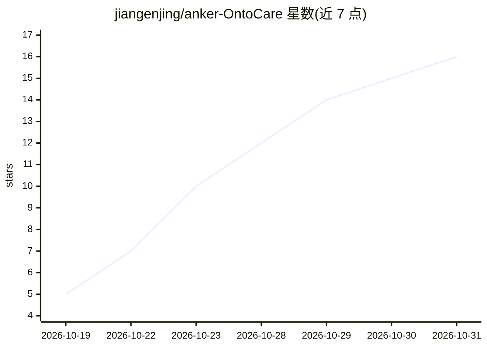

# jiangenjing/anker-OntoCare

⭐ 16 · HTML · 推送 2026-10-27 · [GitHub](https://github.com/jiangenjing/anker-OntoCare) · [官网](https://web-production-195cd.up.railway.app/) · 个人维护 · 中文 README

**本体驱动的售后智能客服与经营归因工作台（黑客松项目）**

Anker 首届黑客松智能服务赛道冠军项目归档：面向复杂售后场景的 Flask Web 应用，将用户求助串成产品消歧、多模态证据提取、排障引导与人工审核的服务链路；商家端提供邮件草稿生成、经营看板与带源表行号和规则 ID 的归因建议。核心机制为 Service/Decision 双本体（JSON 数据＋Python 规则，非 RDF/SPARQL）、Bad Case 驱动的评测改进闭环（Persona 对抗、硬性断言、LLM-as-Judge）。需自行配置 OpenAI 兼容的文字与视觉模型接口，视频处理依赖系统 ffmpeg；现配置面向比赛演示，未含生产认证与审计。

## 筛选速览

| 维度 | 判定 | 备注 |
|---|---|---|
| AI 角色 | `ai-native` | 本体是模型或模型工具 |
| 许可风险 | `none` | — |
| 部署形态 | `desktop` | 安装包/桌面程序 |
| 模型依赖 | — | README 未给出锁定关系 |
| 硬件要求 | — | 无带数字的原话,不猜 |
| 安装摩擦 | `low` | 无编译、无系统依赖或容器化 |
| 成熟度 | — | 结构信号不足 |

## 能力要点

- 双本体组织业务证据与决策边界，答复附来源与本体引用 Trace
- 多模态输入：图片与视频采样画面提取为文字证据后检索
- 经营归因：63 条脱敏工单统计＋候选规则标记，可下钻至 Excel 行号与规则 ID
- 评测工作台：Persona 对抗、硬性断言与 LLM-as-Judge，历史 83.8% 修复后复测 98.6%

## 适用场景

- 在复杂售后场景中做带产品消歧和证据引用的智能排障问答
- 生成可编辑的商家客服邮件草稿并做多语言处理
- 从工单集合生成带证据链的经营核查建议
- 审阅并复现黑客松项目的评测流程与 Bad Case 修复记录

## 场景标签

`聊天机器人` `模型评测` · 领域:对话与助手

## 证据(README 行号)

> L11: 面向复杂售后，将一次零散求助串成产品消歧、证据检索、排障引导与人工审核的服务链路；再将工单集合转化为带源表行号和规则 ID 的经营核查建议。
> L70: - **多模态输入**：支持图片，以及视频采样画面的可见事实提取；文字证据进入既有检索流程。
> L152: |模型表达|基于限定证据组织客服答复与邮件|`grounded_response.py`、`mail_workflow.py`|

## 星数曲线

2026-10-19 5 → 2026-10-31 16（+11）

---
*卡片 v1 · prompt 1.4 · 生成 2026-10-30 · 置信度 mid · 依据 README sha `54336167b8e8` · [字段定义](../../DATASET.md)*
