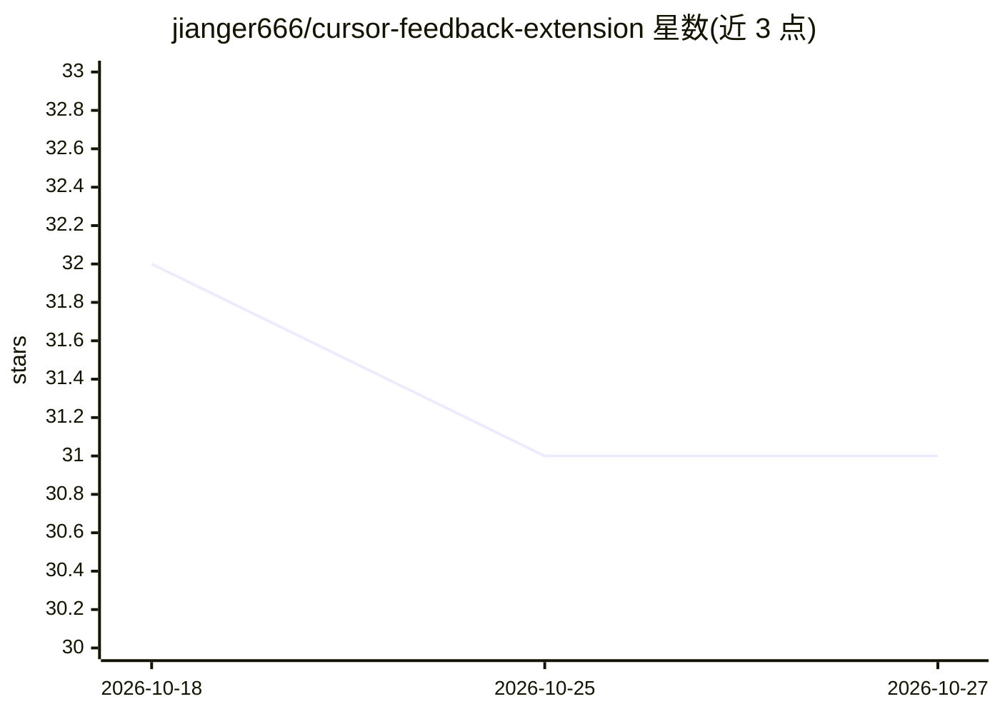

# jianger666/cursor-feedback-extension

⭐ 31 · JavaScript · MIT · 推送 2026-07-15 · [GitHub](https://github.com/jianger666/cursor-feedback-extension) · 个人维护 · 中文 README

**Cursor 交互反馈 MCP 工具：单对话内多次人机交互并接飞书**

为 Cursor 构建的 MCP 交互反馈工具：AI Agent 调用 interactive_feedback 工具后在 IDE 侧栏展示工作摘要并等待用户反馈，从而在一个对话内完成多次交互以节省按次计费配额；支持图片粘贴、文件路径分享与超时自动重试。可通过飞书机器人将反馈请求推送到手机并回复，支持 /new 命令远程启动 Cursor CLI 会话，另有可选后台守护进程使 IDE 关闭后仍可接收消息。以 Cursor 扩展（Open VSX）与 npm 包形式提供。

## 筛选速览

| 维度 | 判定 | 备注 |
|---|---|---|
| AI 角色 | `ai-ecosystem` | LLM/agent 周边工具 |
| 许可风险 | `permissive` | MIT |
| 部署形态 | `library` | 以包/库形式分发 |
| 模型依赖 | — | README 未给出锁定关系 |
| 硬件要求 | — | 无带数字的原话,不猜 |
| 安装摩擦 | `low` | 无编译、无系统依赖或容器化 |
| 成熟度 | — | 结构信号不足 |

## 能力要点

- MCP interactive_feedback 工具：AI 在侧栏展示摘要并等待用户反馈，单对话多轮交互
- 飞书桥接：反馈推送至手机、手机回复路由回 Agent
- /new 命令从手机启动 Cursor CLI 无头会话（含 /status /stop /model 等管理命令）
- 可选后台守护进程：IDE 关闭后仍可用，macOS launchd / Windows 计划任务注册

## 适用场景

- 按次计费套餐下在一个对话内持续与 AI 交互以节省月度配额
- 离开电脑时通过飞书手机端回复 AI 的反馈请求
- 远程从手机发起并管理 Cursor CLI 编码任务

## 场景标签

 · 领域:AI 开发工具/IDE 扩展

## 证据(README 行号)

> L9: **One conversation, unlimited AI interactions** - If you're on a per-request plan, it saves your monthly quota; plus
> L24: - 💬 **Interactive Feedback** - AI Agent requests feedback via MCP tool
> L261: 1. AI Agent calls MCP Server's `interactive_feedback` tool via stdio

## 星数曲线

2026-10-18 32 → 2026-10-27 31（-1）

---
*卡片 v1 · prompt 1.4 · 生成 2026-10-26 · 置信度 high · 依据 README sha `a96423a253a0` · [字段定义](../../DATASET.md)*
