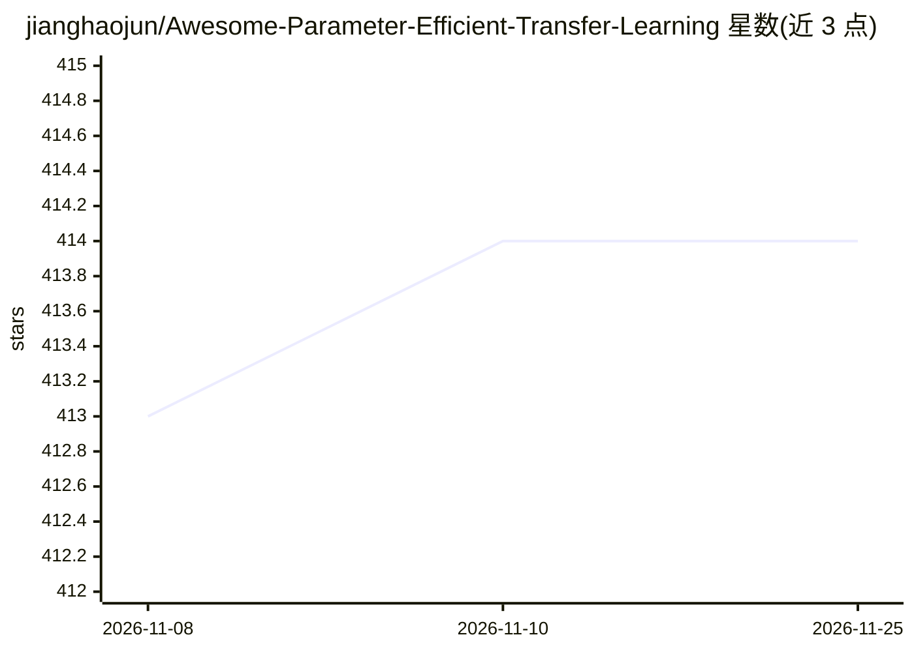

# jianghaojun/Awesome-Parameter-Efficient-Transfer-Learning

⭐ 414 · MIT · 推送 2026-11-07 · [GitHub](https://github.com/jianghaojun/Awesome-Parameter-Efficient-Transfer-Learning) · 个人维护

**参数高效迁移学习论文清单：聚焦视觉与多模态领域**

面向计算机视觉与多模态领域研究者的论文聚合清单，收录参数高效迁移学习（Prompt、Adapter 等方向）的论文条目。每条记录论文标题、发表会议/期刊（CVPR、NeurIPS、ECCV、IJCV 等）、arXiv 编号、作者及论文与代码链接，部分条目附要点说明。条目沿用 PromptPapers 的关键词标注惯例，按 Prompt、Adapter 等类别组织。仓库为纯文献列表，不含可运行代码或安装流程。

## 筛选速览

| 维度 | 判定 | 备注 |
|---|---|---|
| AI 角色 | `ai-knowledge` | 知识聚合/清单类 |
| 许可风险 | `permissive` | MIT |
| 部署形态 | `None` |  |
| 模型依赖 | — | README 未给出锁定关系 |
| 硬件要求 | — | 无带数字的原话,不猜 |
| 安装摩擦 | `low` | 无编译、无系统依赖或容器化 |
| 成熟度 | — | 结构信号不足 |

## 能力要点

- 按 Prompt、Adapter 等类别组织的论文清单
- 每条含发表 venue、arXiv 编号、作者与论文/代码链接
- 聚焦计算机视觉与多模态的参数高效微调方向

## 适用场景

- 查找视觉/多模态领域的 Prompt 与 Adapter 论文
- 跟踪参数高效迁移学习的研究进展
- 为选型或调研定位论文的代码仓库

## 场景标签

`精选清单` · 领域:学习与行业

## 证据(README 行号)

> L2: A collection of parameter-efficient transfer learning papers focusing on computer vision and multimodal domains.
> L22: ## Papers

## 星数曲线

2026-11-08 413 → 2026-11-25 414（+1）

---
*卡片 v1 · prompt 1.4 · 生成 2026-11-17 · 置信度 high · 依据 README sha `7cad9de55d78` · [字段定义](../../DATASET.md)*
