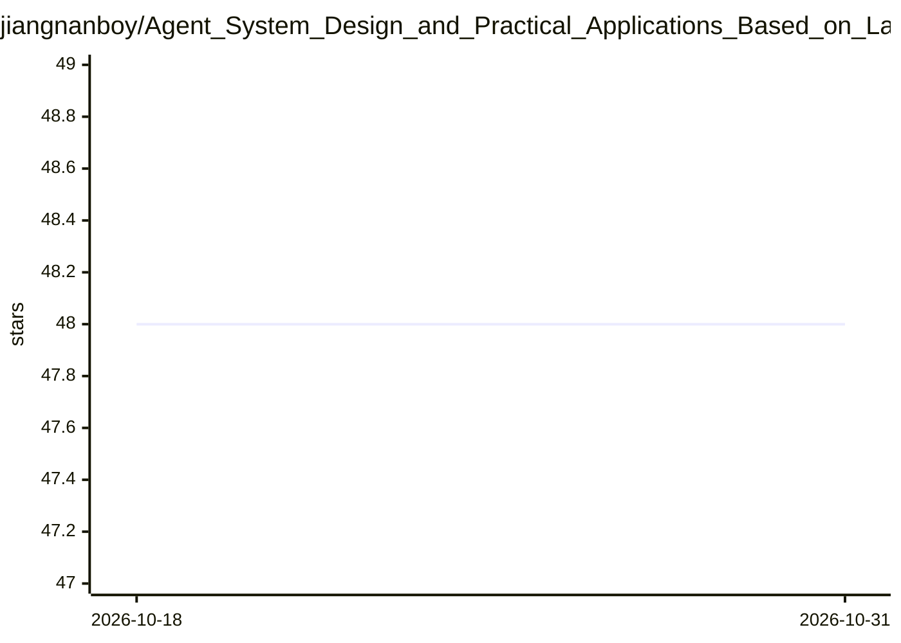

# jiangnanboy/Agent_System_Design_and_Practical_Applications_Based_on_LangChain_and_LangGraph

⭐ 48 · Python · Apache-2.0 · 推送 2025-12-01 · [GitHub](https://github.com/jiangnanboy/Agent_System_Design_and_Practical_Applications_Based_on_LangChain_and_LangGraph) · 个人维护 · 中文 README

**基于 LangChain/LangGraph 的智能体系统实战教程项目（33 章案例）**

以 LangChain（链路编排）与 LangGraph（流程可视化与并行控制）为技术栈的智能体系统教程项目，LLM 以 DeepSeek 为主。内容分三部分：21 章基础篇按提示词链、路由、并行、反思、工具使用、多智能体协同、记忆架构、MCP、A2A、RAG、防护栏等范式各配一个业务案例（如智能客服、电商商品助手、医疗诊断、合同审核），中级篇含 12 个项目实战（如 ChatExcel、中文知识图谱生成、LLM 推理基准测试），高级篇规划企业级综合项目。所有案例声明经本地环境运行测试，依赖通过 requirements.txt 安装。

## 筛选速览

| 维度 | 判定 | 备注 |
|---|---|---|
| AI 角色 | `ai-knowledge` | 知识聚合/清单类 |
| 许可风险 | `permissive` | Apache-2.0 |
| 部署形态 | `None` |  |
| 模型依赖 | — | README 未给出锁定关系 |
| 硬件要求 | — | 无带数字的原话,不猜 |
| 安装摩擦 | `low` | 无编译、无系统依赖或容器化 |
| 成熟度 | — | 结构信号不足 |

## 能力要点

- 21 章基础篇覆盖提示词链/路由/并行/反思/工具使用/多智能体/MCP/A2A/RAG 等范式
- 每章配业务场景案例（电商、客服、教育、医疗、内容创作等）
- LLM 以 DeepSeek 为主，基于 LangChain 与 LangGraph 构建
- 中级篇含 ChatExcel、中文知识图谱生成等 12 个项目实战

## 适用场景

- 系统学习基于 LangChain/LangGraph 的智能体开发范式
- 参考电商、客服、医疗等业务场景的案例代码
- 企业智能体系统开发的技术选型参考

## 场景标签

`教程课程` · 领域:学习与行业

## 证据(README 行号)

> L3: 本项目以《design_and_practice_of_agent_systems》为基础框架，进行了全面的重构与升级，聚焦智能体系统的“实战化”落地能力培养。区别于理论性教程，项目中所有内容模块、案例代码及业务场景均为全新编写，深
> L5: 项目核心技术依托LangChain与LangGraph两大主流框架构建，所有案例均经过本地环境运行测试，确保代码可复现、场景可落地。案例场景均选自电商、客服、教育、内容创作等高频业务领域，覆盖智能体开发的核心技术范式。
> L13: - **技术栈前沿稳定**：基于LangChain（智能体链路编排）与LangGraph（复杂流程可视化与并行控制）构建，llm以deepseek为主，适配企业级部署需求。

## 星数曲线

2026-10-18 48 → 2026-10-31 48（+0）

---
*卡片 v1 · prompt 1.4 · 生成 2026-10-25 · 置信度 high · 依据 README sha `ce02ff874b9f` · [字段定义](../../DATASET.md)*
