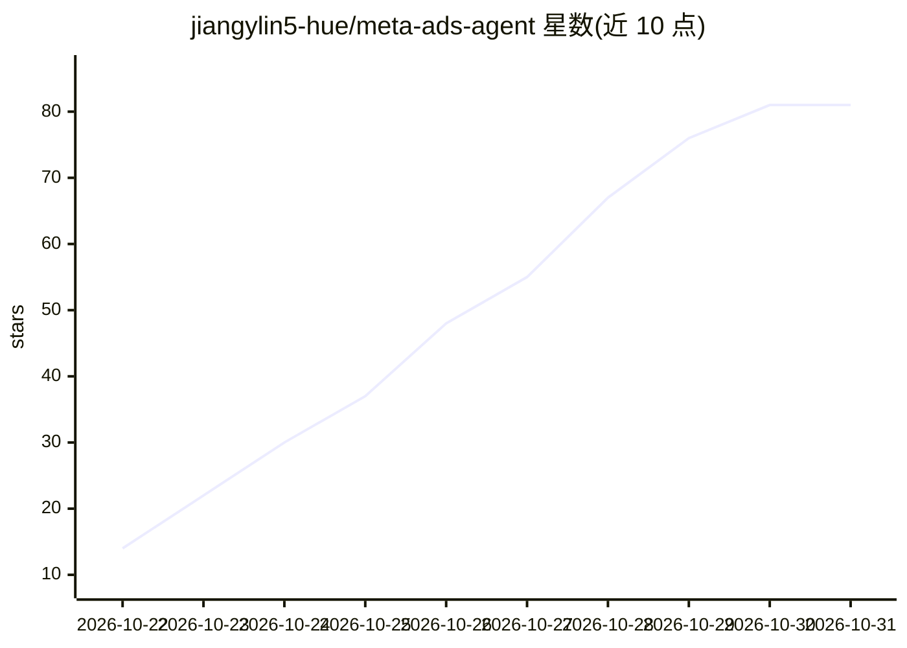

# jiangylin5-hue/meta-ads-agent

⭐ 81 · Python · 推送 2026-10-19 · [GitHub](https://github.com/jiangylin5-hue/meta-ads-agent) · 个人维护

**面向 Meta 广告运营的有界 AI 副驾驶，带审批式草稿工作流**

基于官方 Meta Ads MCP 构建的广告运营 copilot 公开作品集快照：Next.js 前端工作台 + FastAPI 后端，运行带步数/时间/令牌/工具预算限制的 ReAct 循环，默认使用 DeepSeek 模型（OpenAI 兼容接口可选）。提供 12 个项目 Skill（账户简报、诊断、审计、创意、优化等）、五轮对话窗口加摘要压缩、长期 Memory 与可恢复任务状态。写操作仅限通过官方 Draft Mode 创建草稿，激活/更新/删除/发布路径对模型不可用，实际执行返回 410 禁用。本地运行需 Python venv、Postgres（docker compose）与 Meta 凭据环境变量。

## 筛选速览

| 维度 | 判定 | 备注 |
|---|---|---|
| AI 角色 | `ai-native` | 本体是模型或模型工具 |
| 许可风险 | `none` | — |
| 部署形态 | `desktop` | 安装包/桌面程序 |
| 模型依赖 | locked-api |  |
| 硬件要求 | — | 无带数字的原话,不猜 |
| 安装摩擦 | `low` | 无编译、无系统依赖或容器化 |
| 成熟度 | — | 结构信号不足 |

## 能力要点

- 带步数/时间/令牌/工具预算的有界 ReAct 循环
- 12 个项目 Skill 与渐进式工具暴露机制
- 长期 Memory、任务状态与账号缓存（TTL+过期回退）
- 写操作限制在 Draft Mode 草稿创建，激活/发布路径被代码阻断

## 适用场景

- 广告运营人员用对话生成与诊断 Meta 广告投放方案
- 在需人工审批的工作流中安全地起草广告系列/广告组/广告
- 学习 agent 上下文工程与安全边界的参考实现

## 场景标签

`AI 助手` · 领域:对话与助手

## 证据(README 行号)

> L9: A portfolio snapshot of a bounded Meta Ads copilot built around the official Meta Ads MCP, project-level Skills, Dee
> L15: - A bounded ReAct loop with explicit step, time, token, and tool budgets.
> L17: - 12 project Skills covering account briefs, diagnosis, audits, creative, optimization, planning, tracking, audienc

## 星数曲线

2026-10-22 14 → 2026-10-31 81（+67）

---
*卡片 v1 · prompt 1.4 · 生成 2026-10-25 · 置信度 high · 依据 README sha `cec9314caf09` · [字段定义](../../DATASET.md)*
