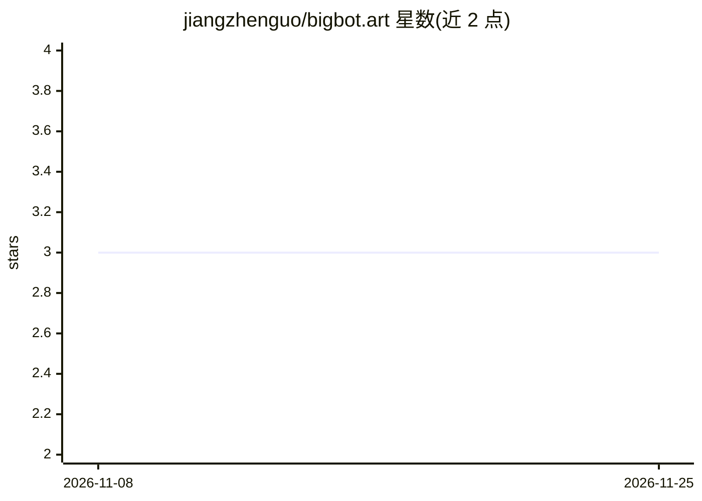

# jiangzhenguo/bigbot.art

⭐ 3 · TypeScript · MIT · 推送 2026-11-10 · [GitHub](https://github.com/jiangzhenguo/bigbot.art) · [官网](https://www.bigbot.art) · 个人维护 · 中文 README

**本地优先无限画布 Agent，一句话生成可编辑视频与图片**

面向 Apple Silicon Mac 的 Electron 桌面应用：Agent 把一句话需求拆成分镜、镜头与图片节点，在无限画布上逐个执行。视频由本地引擎 h3.c（MiniMax-H3 权重约 144GB，Metal 推理）生成，图片由 MLX（mlxgen）生成与编辑，剪辑导出用 ffmpeg；旁白支持 CosyVoice3 音色克隆与 Qwen3-TTS 文字设计音色。数据、素材与成片只写入本机 ~/.bigbotart，无账号无订阅；缺模型时以 dry-run 占位运行。Agent 对话可接 LM Studio、OpenAI 兼容端点或本机 Cursor CLI。

## 筛选速览

| 维度 | 判定 | 备注 |
|---|---|---|
| AI 角色 | `ai-native` | 本体是模型或模型工具 |
| 许可风险 | `permissive` | MIT |
| 部署形态 | `library` | 以包/库形式分发 |
| 模型依赖 | — | README 未给出锁定关系 |
| 硬件要求 | — | 无带数字的原话,不猜 |
| 安装摩擦 | `medium` | 含编译或系统依赖之一 |
| 成熟度 | — | 结构信号不足 |

## 能力要点

- Agent 在无限画布上拆分镜与节点，只重跑受影响节点并保留 Take 记录
- 本地引擎出片：h3.c 生成带音轨视频，MLX 生成与编辑图片
- 节点插件机制，读取 manifest.json 后安装为画布节点
- 项目可导出 .bba 包，换机后按参数重跑产物

## 适用场景

- 在本机一句话生成可逐镜修改的视频成片
- 画布上手动连节点做图片与视频的多步生成
- 给成片克隆音色或用文字设计旁白配音

## 场景标签

`图像生成` `视频生成` `语音合成` · 领域:内容生成

## 证据(README 行号)

> L9: Electron desktop app for Apple Silicon. An agent lays out shots and images on an infinite canvas, then runs them on 
> L13: > **AI 摘要**：BigBotArt 是一款本地优先（local-first）的 macOS 无限画布 AI 视频与图片生成 Agent 应用（Electron + TypeScript，面向 Apple Silicon）。

## 星数曲线

2026-11-08 3 → 2026-11-25 3（+0）

---
*卡片 v1 · prompt 1.4 · 生成 2026-11-21 · 置信度 mid · 依据 README sha `a3a94bcc6679` · [字段定义](../../DATASET.md)*
