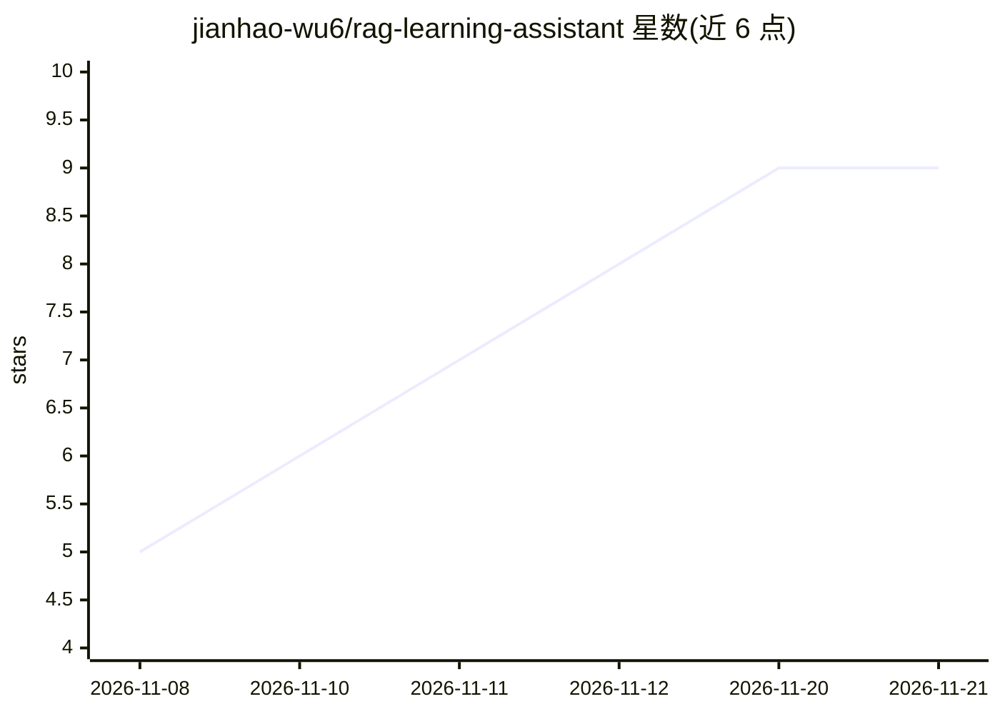

# jianhao-wu6/rag-learning-assistant

⭐ 9 · Python · NOASSERTION · 推送 2026-11-06 · [GitHub](https://github.com/jianhao-wu6/rag-learning-assistant) · 个人维护 · 中文 README

**基于 RAG 全链路的教程知识库学习问答助手**

以 Datawhale all-in-rag 教程文档（29 篇）为知识库构建的问答系统，实现查询路由、查询改写、章节过滤、混合检索（bge-small-zh-v1.5 稠密向量 + BM25）、RRF 融合、Rerank 精排与父子文档召回的完整链路，生成环节调用 DeepSeek API。提供命令行交互与 Streamlit 可视化界面，界面实时展示路由、过滤、检索文档块与耗时。采用 CC BY-NC-SA 4.0 许可，禁止商业用途；运行前需自行克隆上游仓库获取知识库文档。

## 筛选速览

| 维度 | 判定 | 备注 |
|---|---|---|
| AI 角色 | `ai-native` | 本体是模型或模型工具 |
| 许可风险 | `none` | NOASSERTION |
| 部署形态 | `library` | 以包/库形式分发 |
| 模型依赖 | locked-api |  |
| 硬件要求 | — | 无带数字的原话,不猜 |
| 安装摩擦 | `low` | 无编译、无系统依赖或容器化 |
| 成熟度 | — | 结构信号不足 |

## 能力要点

- 混合检索：稠密向量（bge-small-zh-v1.5）+ BM25，RRF 倒数排名融合
- 父子文档检索：小块精准召回，完整文档作为上下文作答
- Streamlit 界面实时展示路由结果、章节过滤、检索文档块与耗时
- 规则查询路由替代 LLM 路由，模糊问题才触发 LLM 改写

## 适用场景

- 以问答方式学习 RAG 教程内容
- 作为 RAG 全链路优化的实践参考代码
- 替换 data 目录与配置后接入自己的知识库

## 场景标签

`RAG` `文档问答` · 领域:知识与检索

## 证据(README 行号)

> L5: 基于 all-in-rag 教程文档（29 篇、338 个文本块）构建的 **RAG（检索增强生成）学习问答系统**，把 RAG 的完整优化链路落地为一个可交互、可追溯的作品。
> L11: - **完整 RAG 优化链**：`查询路由 → 查询改写 → 章节过滤 → 混合检索 → RRF 融合 → Rerank 精排 → 父子文档召回 → 生成`
> L61: 复制 `.env.example` 为 `.env`，并填入 DeepSeek API Key：

## 星数曲线

2026-11-08 5 → 2026-11-21 9（+4）

---
*卡片 v1 · prompt 1.4 · 生成 2026-11-20 · 置信度 high · 依据 README sha `62cb5a384766` · [字段定义](../../DATASET.md)*
