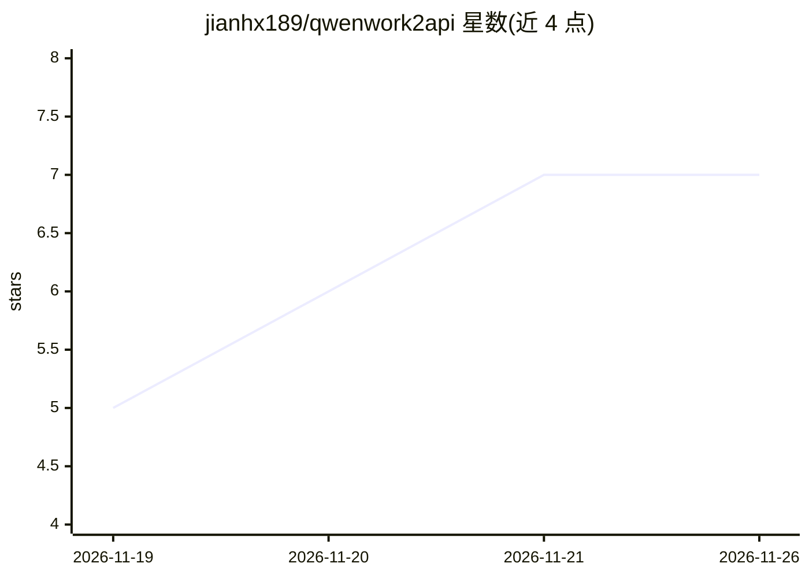

# jianhx189/qwenwork2api

⭐ 7 · HTML · MIT · 推送 2026-11-20 · [GitHub](https://github.com/jianhx189/qwenwork2api) · 个人维护 · 中文 README

**把千问办公积分转为 OpenAI 兼容 API 的自托管网关**

一个 Node.js 反向代理网关：将千问办公（QwenWork）账号的办公积分封装为标准 OpenAI 兼容 API（/v1/chat/completions），对外提供 lite/standard/advanced/ultimate 等档位及 Qwen、DeepSeek、GLM 等模型名映射。零第三方依赖，`node server.mjs` 即可运行，账号与用量存本地 JSON。自带密码登录的控制台，含数据看板、用量分析、调用日志、账号管理、密钥管理六个页面；支持多账号轮转（按剩余积分挑号、401 续期、5xx/429 换号）、模型可用性自检、每日积分自动领取、客户端指纹切换。运行需 Node ≥ 18.17，需从官方客户端 deb 包提取 wasm 签名组件。

## 筛选速览

| 维度 | 判定 | 备注 |
|---|---|---|
| AI 角色 | `ai-ecosystem` | LLM/agent 周边工具 |
| 许可风险 | `permissive` | MIT |
| 部署形态 | `None` |  |
| 模型依赖 | — | README 未给出锁定关系 |
| 硬件要求 | — | 无带数字的原话,不猜 |
| 安装摩擦 | `low` | 无编译、无系统依赖或容器化 |
| 成熟度 | — | 结构信号不足 |

## 能力要点

- 一个 Base URL 提供 OpenAI 兼容接口，映射 9 个对外模型名到上游档位
- 多账号轮转：按剩余积分挑号，401 自动续期、5xx/429 换号重试，已写字节后不重试
- 密码登录控制台：数据看板/用量分析/调用日志/账号/密钥/设置六页面，5 秒自动刷新
- 零第三方依赖，不用 Docker、不用数据库，账号与用量存本地 JSON

## 适用场景

- 让 Claude Code、Codex、Chatbox、OpenWebUI 等客户端通过统一 Base URL 接入千问办公积分
- 自托管管理多个千问办公账号，自动挑号与失败换号
- 在控制台查看调用量、成功率、P95 耗时与积分消耗
- 用模型可用性自检分清套餐权限问题与链路问题

## 场景标签

`模型网关` · 领域:Agent 开发

## 证据(README 行号)

> L3: 把**千问办公**（QwenWork）的办公积分变成标准的 **OpenAI 兼容 API**，自带实时控制台。
> L11: - **一个 Base URL 打通全部档位**：`/v1/chat/completions` 直接用，Claude Code、Codex、Chatbox、DSH、OpenWebUI 都能接。

## 星数曲线

2026-11-19 5 → 2026-11-26 7（+2）

---
*卡片 v1 · prompt 1.4 · 生成 2026-11-20 · 置信度 high · 依据 README sha `6743d4a6344e` · [字段定义](../../DATASET.md)*
