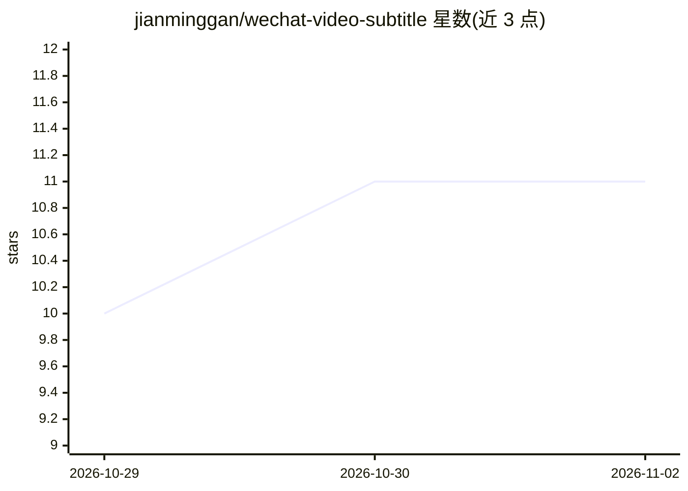

# jianminggan/wechat-video-subtitle

⭐ 11 · Python · MIT · 推送 2026-07-18 · [GitHub](https://github.com/jianminggan/wechat-video-subtitle) · 个人维护 · 中文 README

**下载微信视频号视频与直播回放并转写逐字稿的 Agent Skill**

面向 Codex、Claude Code、Hermes 等能运行本地命令的 AI Agent 的 Skill：给定视频号链接后自动下载普通视频或直播回放，并可通过 ASR 服务（小米 MiMo、硅基流动 SenseVoice、OpenAI Speech-to-Text 或本地 Whisper）把视频转成 Markdown 逐字稿，支持批量处理与本地视频转写。普通视频经腾讯元宝后台解析（首次需扫码登录，Playwright Chromium 实现）；直播回放需在 Windows 微信中手动播放几秒，读取本地网络统计记录获取媒体信息，不录屏、不控制微信。转写支持分段并发、片段缓存与可选错别字纠正。直播回放流程仅支持 Windows 10/11，macOS/Linux 普通视频流程为实验性。

## 筛选速览

| 维度 | 判定 | 备注 |
|---|---|---|
| AI 角色 | `ai-ecosystem` | LLM/agent 周边工具 |
| 许可风险 | `permissive` | MIT |
| 部署形态 | `library` | 以包/库形式分发 |
| 模型依赖 | — | README 未给出锁定关系 |
| 硬件要求 | — | 无带数字的原话,不猜 |
| 安装摩擦 | `medium` | 含编译或系统依赖之一 |
| 成熟度 | `idea` | |

## 能力要点

- 普通视频全自动下载，无需打开微信
- 4 种 ASR 方案（MiMo / 硅基流动 SenseVoice / OpenAI / 本地 Whisper）转写 Markdown 逐字稿
- 音频切 5 分钟片段并发识别，片段结果缓存、失败可续跑
- 兼容 Codex / Claude Code / Hermes 多 Agent 共用一份安装目录

## 适用场景

- 把视频号链接直接发给 AI Agent 下载视频
- 把直播回放或本地视频转成 Markdown 逐字稿
- 批量处理多个视频号链接

## 场景标签

`语音识别` `网页抓取` · 领域:效率与自动化

## 证据(README 行号)

> L3: 把一个微信视频号链接交给 AI Agent，就可以完成：
> L11: 支持 Codex、Claude Code、Hermes 等能够运行本地命令的 AI Agent。

## 星数曲线

2026-10-29 10 → 2026-11-02 11（+1）

---
*卡片 v1 · prompt 1.4 · 生成 2026-11-02 · 置信度 mid · 依据 README sha `a35487c8c9bf` · [字段定义](../../DATASET.md)*
