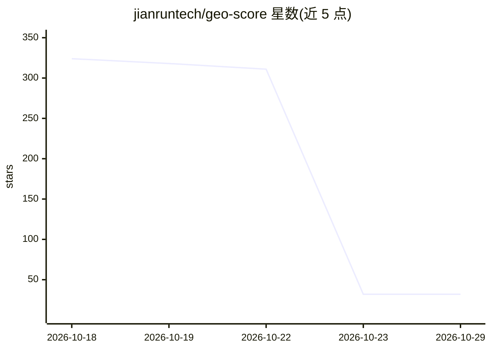

# jianruntech/geo-score

⭐ 32 · Python · MIT · 推送 2026-10-23 · [GitHub](https://github.com/jianruntech/geo-score) · [官网](https://geo-score.dev) · 组织维护 · 中文 README

**网站 AI 可见性（GEO）评分器：测 AI 引擎能否引用你的站点**

由见润科技（Jianrun Tech）开源的 GEO 评分工具：按公开发布、可复算的 v1.1 评分规则，对网站做 21 项分层检查（可达性、可解析性、可信度、可引用性等五支柱、三门禁），输出 0–100 分与优先修复项；第一级免费免安装免密钥。第二、三级用用户自己的 API 密钥向 OpenAI、Perplexity、Gemini、Anthropic、OpenRouter 提问并记录引用来源，结果与分数分开呈现。提供 CLI、GitHub Action 与 MCP server，零依赖、仅用 Python 标准库；另附 324 个站点的公开排行榜。

## 筛选速览

| 维度 | 判定 | 备注 |
|---|---|---|
| AI 角色 | `ai-ecosystem` | LLM/agent 周边工具 |
| 许可风险 | `permissive` | MIT |
| 部署形态 | `self-host` | docker 或自建部署 |
| 模型依赖 | locked-api |  |
| 硬件要求 | — | 无带数字的原话,不猜 |
| 安装摩擦 | `low` | 无编译、无系统依赖或容器化 |
| 成熟度 | — | 结构信号不足 |

## 能力要点

- 公开可复算的 v1.1 评分规则，21 项检查、5 支柱、3 门禁，0–100 分
- Ask/Watch 级别用自有密钥调用 OpenAI/Perplexity/Gemini/Anthropic/OpenRouter API 追踪引用
- 提供 CLI、GitHub Action、MCP server 与 Claude Code skill 四种使用形态
- 零依赖，单文件仅标准库即可运行

## 适用场景

- 发布前检查我的网站能否被 ChatGPT、Perplexity 等 AI 引擎抓取和引用
- 每周跟踪固定问题集上我的站点被引用率与竞争对手对比
- 在 CI 中对站点评分，回归或门禁归零时使构建失败

## 场景标签

 · 领域:AI 搜索可见性/网站优化

## 证据(README 行号)

> L20: geo-score scores a website from 0 to 100 on whether AI answer engines can reach it, parse it, trust it and cite it,
> L122: |**Ask** (level 2)|Puts one question to ChatGPT, Perplexity, Gemini and Claude through their search-enabled APIs, 
> L125: |**MCP server**|All three levels as tools for agents over stdio; `--read-only` gives a server that cannot spend|MC

## 星数曲线

2026-10-18 324 → 2026-10-29 32（-292）

---
*卡片 v1 · prompt 1.4 · 生成 2026-10-22 · 置信度 mid · 依据 README sha `0c361bf0201e` · [字段定义](../../DATASET.md)*
