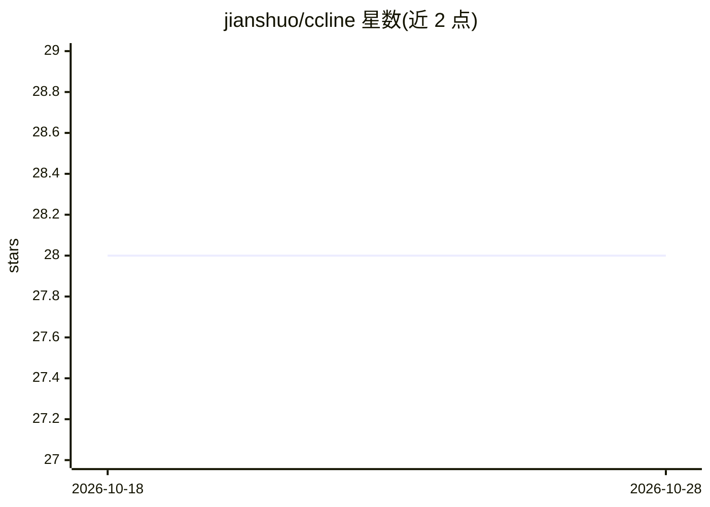

# jianshuo/ccline

⭐ 28 · Shell · MIT · 推送 2026-06-16 · [GitHub](https://github.com/jianshuo/ccline) · [官网](https://ccline.jianshuo.dev) · 个人维护

**在 zsh 提示符直接输入想法、获得回答并执行命令的 CLI 工具**

利用 zsh 的 command_not_found_handler：输入非命令的多词内容时整行交给 LLM CLI 处理，回答以 Markdown 渲染，可运行命令以方向键菜单展示，确认后在当前活动 shell 中执行（cd/export/历史生效）。后端依次自动检测 claude、codex、pi CLI，可用 CCLINE_BACKEND 与 CCLINE_MODEL 覆盖。Markdown 渲染优先用 glow，否则用内置 perl 渲染器。要求 zsh 与一个已认证的 LLM CLI，另提供 Fish 支持安装器。限制：裸 * 会触发 glob 展开，单词输入不送 LLM。

## 筛选速览

| 维度 | 判定 | 备注 |
|---|---|---|
| AI 角色 | `ai-native` | 本体是模型或模型工具 |
| 许可风险 | `permissive` | MIT |
| 部署形态 | `None` |  |
| 模型依赖 | locked-api |  |
| 硬件要求 | — | 无带数字的原话,不猜 |
| 安装摩擦 | `low` | 无编译、无系统依赖或容器化 |
| 成熟度 | — | 结构信号不足 |

## 能力要点

- 劫持 zsh command_not_found_handler，无需前缀直接提问
- 答案中的命令经确认后在活动 shell 执行（cd/export/历史持久）
- 后端自动检测 claude/codex/pi CLI，可用环境变量覆盖后端与模型
- Markdown 渲染用 glow 或内置 perl 渲染器，无额外依赖

## 适用场景

- 在终端里忘了命令时直接用自然语言提问并一键执行
- 不切换窗口就获得带可运行命令的回答
- macOS zsh 用户希望以最小摩擦调用 LLM CLI

## 场景标签

`AI 助手` · 领域:对话与助手

## 证据(README 行号)

> L6: Type a thought directly at your shell prompt — no command, no prefix — and get
> L38: - **Two or more words** → treated as a thought, sent to your LLM CLI. The answer
> L44: It uses the `claude` CLI if installed

## 星数曲线

2026-10-18 28 → 2026-10-28 28（+0）

---
*卡片 v1 · prompt 1.4 · 生成 2026-10-26 · 置信度 high · 依据 README sha `0ebe5799e13d` · [字段定义](../../DATASET.md)*
