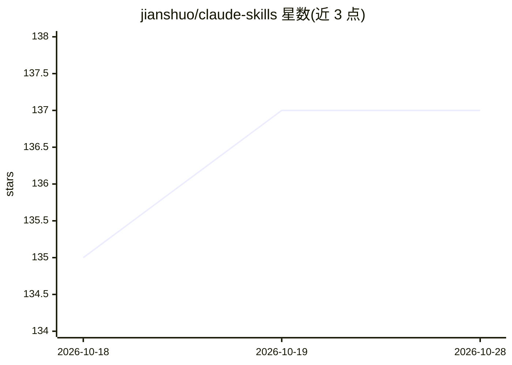

# jianshuo/claude-skills

⭐ 137 · Python · MIT · 推送 2026-10-27 · [GitHub](https://github.com/jianshuo/claude-skills) · 个人维护 · 中文 README

**Claude Code 个人的 40+ 个 skill 集合：视频制作与公众号写作工作流**

王建硕日常使用的 Claude Code skills 集合，以 SKILL.md 格式（Anthropic 标准）编写，由 PostToolUse hook 自动从 ~/.claude/skills/ 同步发布。工作流覆盖视频创作（转写、字幕翻译、TTS 配音、烧字幕、多机位对齐与自动剪辑、切片、横竖屏转换、批量上传 YouTube）与公众号写作（润色发文、从字幕/语音备忘挖文章），以及文章转竖屏短视频、有声书合成、多平台分发、prompt 盲评等。兼容 Claude Code、OpenAI Codex CLI、Cursor、Gemini CLI。安装方式为复制 skill 目录到 ~/.claude/skills/ 或通过 ClawHub 安装。

## 筛选速览

| 维度 | 判定 | 备注 |
|---|---|---|
| AI 角色 | `ai-ecosystem` | LLM/agent 周边工具 |
| 许可风险 | `permissive` | MIT |
| 部署形态 | `library` | 以包/库形式分发 |
| 模型依赖 | — | README 未给出锁定关系 |
| 硬件要求 | — | 无带数字的原话,不猜 |
| 安装摩擦 | `medium` | 含编译或系统依赖之一 |
| 成熟度 | — | 结构信号不足 |

## 能力要点

- 「转写→翻译→配音→烧字幕」四步视频本地化流水线，可单步或编排运行
- 多机位音频互相关对齐与音量切机位自动剪辑
- 从视频字幕/语音备忘挖掘生成公众号文章并上传草稿
- SKILL.md 标准格式，兼容 Claude Code / Codex CLI / Cursor / Gemini CLI

## 适用场景

- 用自然语言驱动 Claude Code 完成视频转写、翻译与配音本地化
- 把视频或语音口述内容整理成微信公众号文章
- 将文章自动做成竖屏解说短视频并发布到各平台

## 场景标签

`工作流自动化` `语音合成` `语音识别` `AI 写作` · 领域:效率与自动化

## 证据(README 行号)

> L44: Claude Code skill 是一个带 frontmatter 的 `SKILL.md` 文件 + 一组脚本。当用户的请求匹配 skill 描述里的触发词（"翻译字幕"、"做封面"、"上传 YouTube"……）时，Clau
> L46: 这套 skill 大致围绕 **「视频创作 + 公众号写作」** 工作流：从原始拍摄素材 → 多机位对齐 → 自动剪辑 → 翻译配音 → 后期合成 → 平台分发。每个 skill 都做一件事，可以单独调用，也可以串成完整流水线。

## 星数曲线

2026-10-18 135 → 2026-10-28 137（+2）

---
*卡片 v1 · prompt 1.4 · 生成 2026-10-22 · 置信度 mid · 依据 README sha `18bc9797e831` · [字段定义](../../DATASET.md)*
