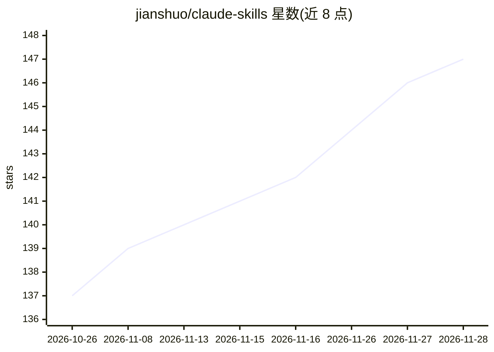

# jianshuo/claude-skills

⭐ 147 · JavaScript · MIT · 推送 2026-11-27 · [GitHub](https://github.com/jianshuo/claude-skills) · 个人维护 · 中文 README

**作者日常在 Claude Code 使用的视频创作与公众号写作 skills 合集**

作者（王建硕）将其 Claude Code skills 目录自动镜像到 GitHub：每个 skill 是带 frontmatter 的 SKILL.md 加脚本，按触发词被 Claude 自动加载执行。围绕「视频创作 + 公众号写作」流水线组织，涵盖音频转写、字幕翻译、TTS 配音、多机位同步剪辑、长视频切片、横竖屏转换、公众号文章生成与上传、文章转短视频、文字转有声书、X/Bluesky 等平台分发。安装方式为把 skill 目录复制到 Claude Code 的 skills 目录，或经 ClawHub 安装；兼容遵循 SKILL.md 格式的其他 CLI。

## 筛选速览

| 维度 | 判定 | 备注 |
|---|---|---|
| AI 角色 | `ai-knowledge` | 知识聚合/清单类 |
| 许可风险 | `permissive` | MIT |
| 部署形态 | `library` | 以包/库形式分发 |
| 模型依赖 | — | README 未给出锁定关系 |
| 硬件要求 | — | 无带数字的原话,不猜 |
| 安装摩擦 | `medium` | 含编译或系统依赖之一 |
| 成熟度 | — | 结构信号不足 |

## 能力要点

- SKILL.md 格式 skill 合集，触发词自动加载或斜杠命令显式调用
- 覆盖视频本地化流水线：转写→翻译→配音→烧字幕→上传
- 支持微信公众号写作与草稿上传、文章转竖屏解说短视频
- 自动镜像：PostToolUse hook 将本地 skills 目录 rsync 推送到 GitHub

## 适用场景

- 把拍摄素材整理成多机位剪辑和带字幕的成片
- 将视频字幕挖掘成多篇公众号文章并上传草稿
- 把公众号文章做成竖屏解说短视频发布
- 给视频做多语言字幕与配音本地化

## 场景标签

`语音合成` `语音识别` `AI 写作` · 领域:内容生成

## 证据(README 行号)

> L34: `SKILL.md` 是 Anthropic 公开的 skill 格式标准（2025 年 10 月发布，2025 年 12 月被 OpenAI Codex 采纳），所以这套 skill 同样适用于:
> L44: Claude Code skill 是一个带 frontmatter 的 `SKILL.md` 文件 + 一组脚本。当用户的请求匹配 skill 描述里的触发词（"翻译字幕"、"做封面"、"上传 YouTube"……）时，Clau
> L46: 这套 skill 大致围绕 **「视频创作 + 公众号写作」** 工作流：从原始拍摄素材 → 多机位对齐 → 自动剪辑 → 翻译配音 → 后期合成 → 平台分发。每个 skill 都做一件事，可以单独调用，也可以串成完整流水线。

## 星数曲线

2026-10-26 137 → 2026-11-28 147（+10）

---
*卡片 v1 · prompt 1.4 · 生成 2026-11-27 · 置信度 mid · 依据 README sha `b2225ca515ce` · [字段定义](../../DATASET.md)*
