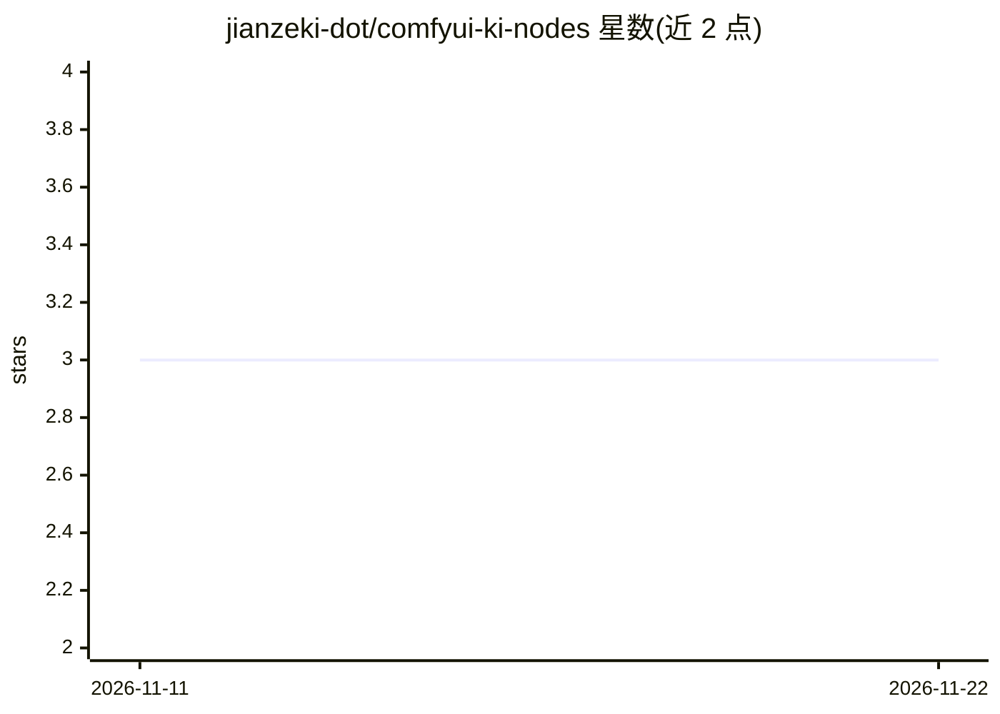

# jianzeki-dot/comfyui-ki-nodes

⭐ 3 · JavaScript · 推送 2026-10-26 · [GitHub](https://github.com/jianzeki-dot/comfyui-ki-nodes) · [官网](https://github.com/jianzeki-dot/comfyui-ki-nodes) · 个人维护 · 中文 README

**面向 ComfyUI 用户的 24 个自定义节点合集，覆盖视频续接、采样加速与调色**

由 9 个原独立插件合并的 ComfyUI 自定义节点包，含 24 个节点：MiniMax H3 长视频续接、接缝匹配与尾部 latent 存取、SelfLift 渐进分辨率采样、Z-Image 跳步加速、视频调色台（255 个内置 LUT）、宫格拼图与标注、360° 全景预览。零 pip 依赖，仅用 ComfyUI 自带环境，通过 git clone 到 custom_nodes 安装。部分节点需 ComfyUI 内核含 MiniMax H3 支持；VideoHelperSuite 为唯一可选依赖。派生自 GPL-3.0 项目的部分受 GPL-3.0 约束。

## 筛选速览

| 维度 | 判定 | 备注 |
|---|---|---|
| AI 角色 | `ai-native` | 本体是模型或模型工具 |
| 许可风险 | `none` | — |
| 部署形态 | `None` |  |
| 模型依赖 | — | README 未给出锁定关系 |
| 硬件要求 | — | 无带数字的原话,不猜 |
| 安装摩擦 | `medium` | 含编译或系统依赖之一 |
| 成熟度 | — | 结构信号不足 |

## 能力要点

- 24 个节点由 9 个独立插件合并，节点 ID 与旧工作流保持兼容
- MiniMax H3 长视频续接：尾部 latent 固定帧与音画相位校验
- Z-Image 整步跳过加速：最小二乘轨迹外推与偏差预算门控
- 视频调色台内置 255 个 .cube LUT，逐批处理固定显存预算

## 适用场景

- 在 ComfyUI 中做多段 H3 长视频续接并保持音画连续
- 跳过扩散采样步以减少 Z-Image 生成的显存搬运
- 视频加载与合成阶段做白平衡/曲线/HSL/LUT 调色
- 拼接多张生成图为宫格并带序号标注

## 场景标签

`图像生成` `视频生成` `图像视频处理` · 领域:内容生成

## 证据(README 行号)

> L3: > 19 个 ComfyUI 自定义节点合集：360° 全景预览、MiniMax H3 音视频增强、Z-Image 采样加速、SelfLift 渐进分辨率采样、视频调色台、宫格拼图。
> L12: - **零 pip 依赖**：不需要 requirements.txt，只用 ComfyUI 自带环境（torch / numpy / Pillow / ffmpeg）。
> L13: - **24 个节点，一个包**：由 9 个原独立插件合并，节点 ID、显示名、前端扩展名全部保持不变，旧工作流不用重连。

## 星数曲线

2026-11-11 3 → 2026-11-22 3（+0）

---
*卡片 v1 · prompt 1.4 · 生成 2026-11-21 · 置信度 high · 依据 README sha `eb3f24594623` · [字段定义](../../DATASET.md)*
