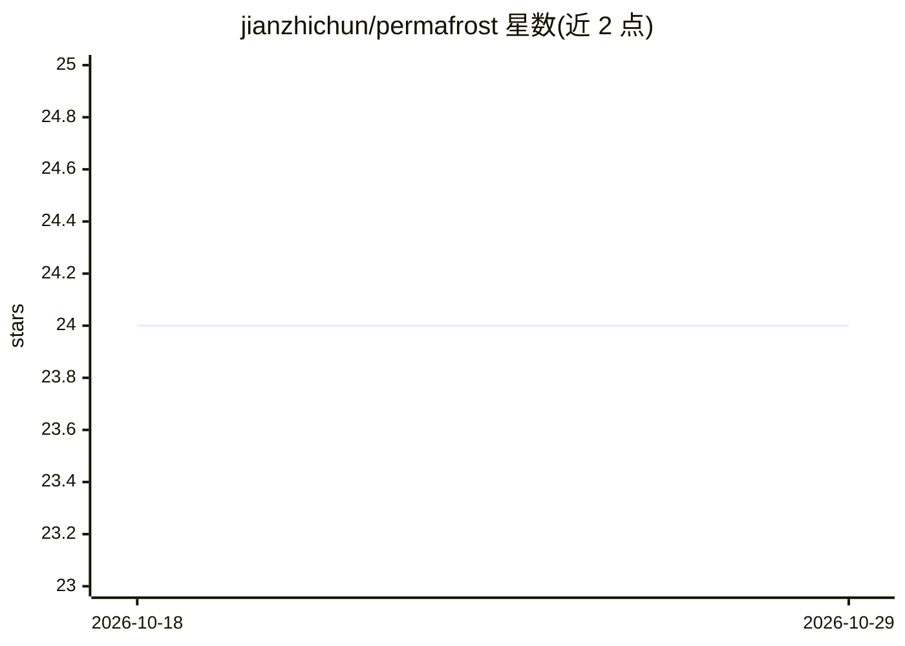

# jianzhichun/permafrost

⭐ 24 · Python · MIT · 推送 2026-06-23 · [GitHub](https://github.com/jianzhichun/permafrost) · 个人维护

**保持 DeepSeek 前缀缓存命中的 Claude Code 对齐代理插件**

位于 Claude Code 与 DeepSeek Anthropic 兼容端点之间的透传代理：对每个 /v1/messages 请求确定性排序工具列表、冻结 env 块并只发送增量、剥离 TodoWrite 提醒与 cache_control 标记、规范化序列化，使 tools+system 前缀锚点逐字节稳定，从而维持 DeepSeek prompt cache 命中。另含冷锚点合并（并行子代理等待首个请求暖缓存）、可选空闲 keepalive 重放、命中率状态栏与诊断命令。实测工具列表频繁变动的会话命中率从 33% 提升到 71%，原生稳定会话无差异。零依赖 stdlib Python，可作 CC 插件或独立代理运行。

## 筛选速览

| 维度 | 判定 | 备注 |
|---|---|---|
| AI 角色 | `ai-ecosystem` | LLM/agent 周边工具 |
| 许可风险 | `permissive` | MIT |
| 部署形态 | `None` |  |
| 模型依赖 | locked-api |  |
| 硬件要求 | — | 无带数字的原话,不猜 |
| 安装摩擦 | `low` | 无编译、无系统依赖或容器化 |
| 成熟度 | — | 结构信号不足 |

## 能力要点

- 工具列表确定性排序与环境块冻结+增量，保持缓存前缀逐字节稳定
- 冷锚点合并：并行 Task 子代理共享暖缓存（实测 0%→73%）
- 可选空闲 keepalive 重放防止前缀被逐出
- 命中率状态栏、/permafrost:status 等诊断命令与逐字节锚点 diff

## 适用场景

- Claude Code 接 DeepSeek 且使用 MCP 服务器导致缓存失效时降低成本
- 并行子代理扇出场景下合并冷锚点请求
- 查看会话级缓存命中率与节省金额

## 场景标签

`模型网关` · 领域:Agent 开发

## 证据(README 行号)

> L18: byte 0. Permafrost sits between CC and DeepSeek and rewrites the cache-relevant
> L23:   Claude Code ──Anthropic /v1/messages──▶ Permafrost ──▶ DeepSeek /anthropic
> L76: On every `/v1/messages` request, the pipeline

## 星数曲线

2026-10-18 24 → 2026-10-29 24（+0）

---
*卡片 v1 · prompt 1.4 · 生成 2026-10-27 · 置信度 high · 依据 README sha `0d71e2a5a62f` · [字段定义](../../DATASET.md)*
