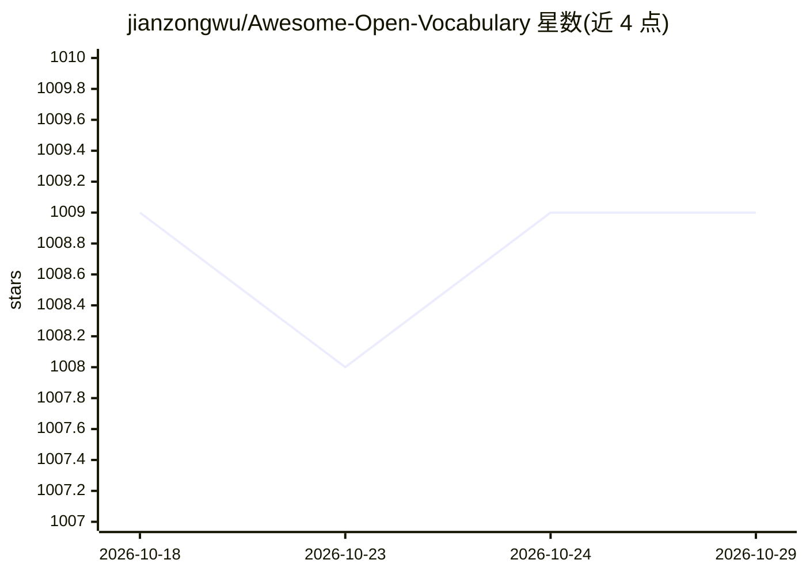

# jianzongwu/Awesome-Open-Vocabulary

⭐ 1,009 · 推送 2026-05-12 · [GitHub](https://github.com/jianzongwu/Awesome-Open-Vocabulary) · [官网](https://arxiv.org/abs/2306.15880) · 组织维护

**开放词汇学习综述配套论文清单：追踪检测/分割/跟踪方法**

TPAMI 2024 综述《Towards Open Vocabulary Learning: A Survey》的配套仓库，用于记录、追踪开放词汇学习方法并补充综述内容。按开放词汇目标检测、语义分割、统一分割等任务分类罗列论文（年份、会议、关键词、代码链接），并用 cap./vlm./pl./sam 等关键词标注方法所用机制（caption 辅助训练、预训练 VLM、伪标签等）。接受社区 PR 补充论文，计划随综述版本更新收录。给计算机视觉研究者做文献调研与方法选型用。

## 筛选速览

| 维度 | 判定 | 备注 |
|---|---|---|
| AI 角色 | `ai-knowledge` | 知识聚合/清单类 |
| 许可风险 | `none` | — |
| 部署形态 | `None` |  |
| 模型依赖 | — | README 未给出锁定关系 |
| 硬件要求 | — | 无带数字的原话,不猜 |
| 安装摩擦 | `low` | 无编译、无系统依赖或容器化 |
| 成熟度 | — | 结构信号不足 |

## 能力要点

- 按任务分类罗列开放词汇检测/分割论文及代码链接
- 关键词体系标注方法机制（caption/VLM/伪标签/SAM/扩散模型等）
- 收录论文更新至 2024/1/10，接受社区 PR 补充

## 适用场景

- 调研开放词汇检测与分割领域的论文与代码
- 按机制关键词（如 vlm.、pl.）筛选同类方法
- 配合综述论文了解领域全景与代表结果对比

## 场景标签

`科研工具` `精选清单` · 领域:学习与行业

## 证据(README 行号)

> L40: This repo is used for recording, tracking, and benchmarking several recent open vocabulary methods to supplement ou
> L70: This survey presents the first detailed survey on open vocabulary tasks, including open-vocabulary object detection

## 星数曲线

2026-10-18 1,009 → 2026-10-29 1,009（+0）

---
*卡片 v1 · prompt 1.4 · 生成 2026-10-21 · 置信度 high · 依据 README sha `783cf96efd4a` · [字段定义](../../DATASET.md)*
