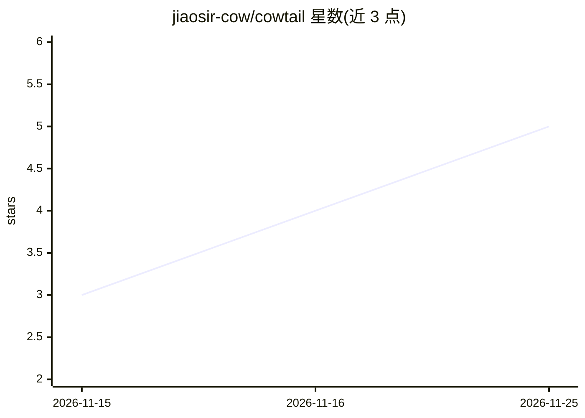

# jiaosir-cow/cowtail

⭐ 5 · Python · NOASSERTION · 推送 2026-11-15 · [GitHub](https://github.com/jiaosir-cow/cowtail) · 组织维护 · 中文 README

**奶牛尾根 9 轴 IMU 行为标注数据集（4 类行为）**

随 COWMATA Pro 发布的公开数据仓库：按行为分文件夹存放尾根加速度窗口，提供 standing/lying/walking/feeding 四类标签，每条样本为 float32 数组（3 轴、256 点，50 Hz、5.12 秒、非重叠）。共 29,790 个窗口，文件不携带动物、设备、会话或时间信息。README 给出加载示例脚本与 numpy 读取方式，附 BibTeX/CITATION.cff 引用条目；数据许可 CC BY 4.0，代码许可 MIT。

## 筛选速览

| 维度 | 判定 | 备注 |
|---|---|---|
| AI 角色 | `ai-knowledge` | 知识聚合/清单类 |
| 许可风险 | `none` | NOASSERTION |
| 部署形态 | `library` | 以包/库形式分发 |
| 模型依赖 | — | README 未给出锁定关系 |
| 硬件要求 | — | 无带数字的原话,不猜 |
| 安装摩擦 | `low` | 无编译、无系统依赖或容器化 |
| 成熟度 | — | 结构信号不足 |

## 能力要点

- 29,790 个已标注加速度窗口，覆盖 4 类行为
- 统一格式 float32、形状 (windows, 3, 256)，50 Hz 非重叠采样
- 提供加载示例脚本与 numpy 读取方式
- 数据 CC BY 4.0，代码 MIT，附 CITATION.cff

## 适用场景

- 获取奶牛行为识别的标注训练数据
- 评估行为分类模型在该数据集上的表现
- 精准畜牧传感器数据分析研究

## 场景标签

 · 领域:精准畜牧/数据集

## 证据(README 行号)

> L18: This is the public data repository released with COWMATA Pro.
> L24: Each folder is one behaviour. All labelled windows are mixed in that folder. The files do not identify animals, dev
> L33: 29,790 windows in total. Each array is `float32` with shape `(windows, 3, 256)`: x, y, z acceleration in approximat

## 星数曲线

2026-11-15 3 → 2026-11-25 5（+2）

---
*卡片 v1 · prompt 1.4 · 生成 2026-11-21 · 置信度 mid · 依据 README sha `287f54b5021f` · [字段定义](../../DATASET.md)*
