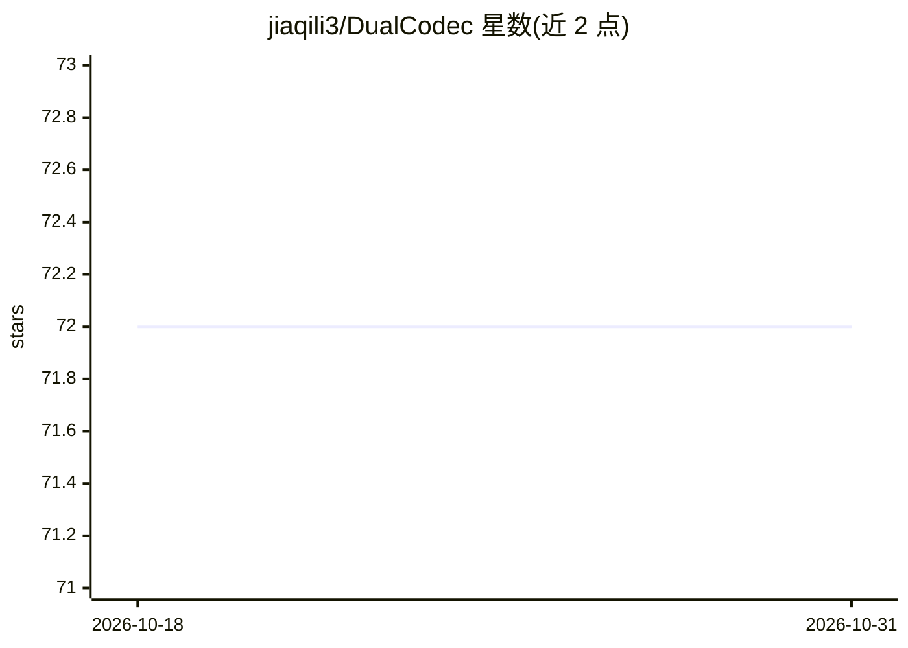

# jiaqili3/DualCodec

⭐ 72 · Jupyter Notebook · MIT · 推送 2026-09-09 · [GitHub](https://github.com/jiaqili3/DualCodec) · [官网](https://dualcodec.github.io) · 个人维护 · 中文 README

**面向语音生成的低帧率语义增强神经音频编解码器**

Interspeech 2025 论文对应的神经音频编解码器实现：在 12.5Hz 或 25Hz 低帧率下工作，结合 w2v-bert-2.0 SSL 特征做语义增强，通过 RVQ 量化提取离散 token 供语音生成使用。提供 12hz_v1 与 25hz_v1 两个基于 100K 小时 Emilia 数据训练的模型，支持从 Hugging Face 自动下载或本地 checkpoint 推理，附 Gradio 界面与 Colab 示例。另含基于它的 TTS 模型（DualCodec-VALLE、DualCodec-Voicebox），并给出从零训练与微调指令（需自行更换全量数据集与更大 batch size）。

## 筛选速览

| 维度 | 判定 | 备注 |
|---|---|---|
| AI 角色 | `ai-native` | 本体是模型或模型工具 |
| 许可风险 | `permissive` | MIT |
| 部署形态 | `library` | 以包/库形式分发 |
| 模型依赖 | — | README 未给出锁定关系 |
| 硬件要求 | — | 无带数字的原话,不猜 |
| 安装摩擦 | `low` | 无编译、无系统依赖或容器化 |
| 成熟度 | — | 结构信号不足 |

## 能力要点

- 12.5Hz/25Hz 低帧率、RVQ 量化层数可变的编解码
- 基于 w2v-bert-2.0 SSL 特征的语义增强设计
- 附带 DualCodec-VALLE / DualCodec-Voicebox 两个 TTS 模型
- 提供从零训练与微调流程及训练 loss 曲线

## 适用场景

- 为 TTS / 语音生成系统提取低帧率离散 audio token
- 基于零样本 TTS 模型做参考音频克隆合成
- 研究低帧率神经编解码器的训练与微调

## 场景标签

`语音合成` `微调` · 领域:内容生成

## 证据(README 行号)

> L11: DualCodec is a low-frame-rate (12.5Hz or 25Hz), semantically-enhanced (with SSL feature) Neural Audio Codec designe
> L25: - 2025-05-19: DualCodec is accepted to Interspeech 2025!

## 星数曲线

2026-10-18 72 → 2026-10-31 72（+0）

---
*卡片 v1 · prompt 1.4 · 生成 2026-10-24 · 置信度 high · 依据 README sha `beb776cf2600` · [字段定义](../../DATASET.md)*
