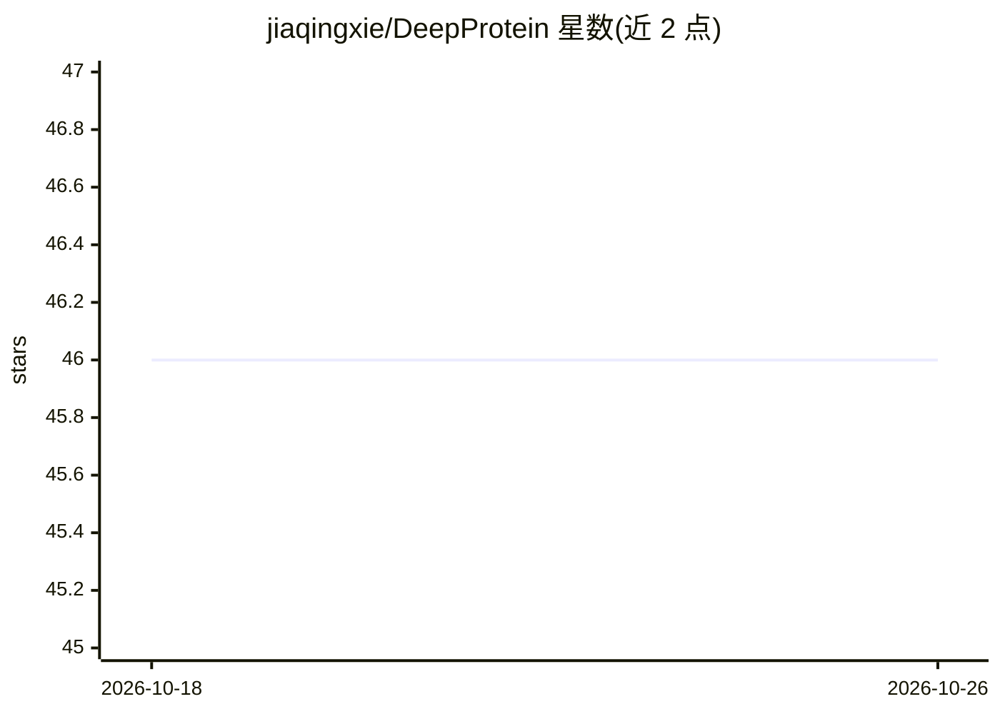

# jiaqingxie/DeepProtein

⭐ 46 · Jupyter Notebook · MIT · 推送 2026-03-30 · [GitHub](https://github.com/jiaqingxie/DeepProtein) · [官网](https://doi.org/10.1093/bioinformatics/btaf165) · 个人维护

**蛋白质序列深度学习库与基准，覆盖 7 类蛋白质任务**

面向蛋白质研究的 PyTorch 深度学习库与基准：以 CNN、RNN、Transformer 及 torch-geometric 图编码器（PyG_GCN/GAT/GraphSAGE/GIN 等）训练和评测蛋白质性质预测、亚细胞定位、蛋白质相互作用、抗原表位、抗体互补位与可开发性等任务。2.0 版将图路径迁移到 torch-geometric，移除核心包的 DGL 依赖，旧 DGL 编码器仅保留兼容存根；残基级任务仅支持 Token_CNN/Token_CNN_RNN/Token_Transformer。提供 CLI 脚本、数据集加载器、Colab 教程，已被 Bioinformatics 接收，另发布 DeepProtT5 系列模型于 Hugging Face。

## 筛选速览

| 维度 | 判定 | 备注 |
|---|---|---|
| AI 角色 | `ai-native` | 本体是模型或模型工具 |
| 许可风险 | `permissive` | MIT |
| 部署形态 | `library` | 以包/库形式分发 |
| 模型依赖 | — | README 未给出锁定关系 |
| 硬件要求 | — | 无带数字的原话,不猜 |
| 安装摩擦 | `medium` | 含编译或系统依赖之一 |
| 成熟度 | — | 结构信号不足 |

## 能力要点

- 统一库界面覆盖单蛋白、PPI 配对与残基级任务
- torch-geometric 图编码器（6 种 PyG 模型）+ 拉普拉斯位置编码可选项
- 支持蛋白质语言模型编码：ProtT5、ESM-1b、ESM-2、Prot-Bert
- 一行命令训练，附 Colab 数据集/训练/推理教程

## 适用场景

- 训练模型预测蛋白质性质或亚细胞定位
- 基准比较 CNN/Transformer/GNN 在蛋白质任务上的表现
- 预测蛋白质相互作用亲和力与抗体可开发性
- 用 DeepProtT5 预训练模型做折叠结构等任务推理

## 场景标签

`模型训练` `模型评测` · 领域:评测与运维

## 证据(README 行号)

> L33: 1. **Comprehensive Benchmarking**: Evaluating CNNs, RNNs, transformers, and GNNs on 7 essential protein learning ta
> L3:  DeepProtein: Deep Learning Library and Benchmark for Protein Sequence Learning

## 星数曲线

2026-10-18 46 → 2026-10-26 46（+0）

---
*卡片 v1 · prompt 1.4 · 生成 2026-10-25 · 置信度 high · 依据 README sha `6f459ec5fc9a` · [字段定义](../../DATASET.md)*
