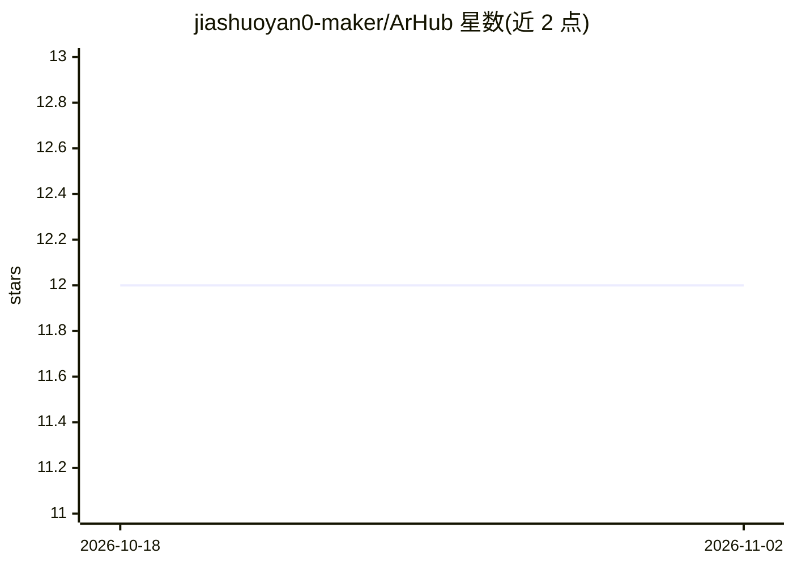

# jiashuoyan0-maker/ArHub

⭐ 12 · JavaScript · MIT · 推送 2026-10-31 · [GitHub](https://github.com/jiashuoyan0-maker/ArHub) · 个人维护 · 中文 README

**科研写作/数据分析用桌面 Agent 工作台（Electron+FastAPI）**

基于 Electron、FastAPI 与 OpenAI-compatible 模型接口的桌面 Agent 工作台，面向科研写作、数据分析和工程任务。Agent 对话为主工作区，文件树、Markdown/LaTeX 编辑器与预览按需展开；执行者、审稿者、编辑器助手可分别配置 Base URL、API Key 与 Model ID（DeepSeek、GLM 等共用连接层），也可切换本机 Claude Code。支持带检查点、产物管理与断点恢复的多步骤 Skill 工作流、Agent 文件 diff 应用/丢弃/撤销、DOCX 导出。前端为安装产物重建，原始 Vite 模块图未恢复；Windows 安装器未签名。

## 筛选速览

| 维度 | 判定 | 备注 |
|---|---|---|
| AI 角色 | `ai-native` | 本体是模型或模型工具 |
| 许可风险 | `permissive` | MIT |
| 部署形态 | `desktop` | 安装包/桌面程序 |
| 模型依赖 | — | README 未给出锁定关系 |
| 硬件要求 | — | 无带数字的原话,不猜 |
| 安装摩擦 | `low` | 无编译、无系统依赖或容器化 |
| 成熟度 | — | 结构信号不足 |

## 能力要点

- 三个 Agent 独立配置 OpenAI-compatible 模型接口或本机 Claude Code
- 多步骤 Skill 工作流：检查点、暂停恢复、产物持久化
- Agent 文件 diff 的应用/丢弃/撤销审阅
- Markdown 导出 DOCX，预览 PDF/DOCX/Markdown/图片

## 适用场景

- 在对话旁完成科研写作的检索、分析、绘图与文档生成
- 为执行、审稿、写作分别指派不同模型跑完整科研流水线
- 用检查点暂停/恢复/重跑单个 Agent 步骤

## 场景标签

`科研工具` `数据分析` `AI 写作` · 领域:效率与自动化

## 证据(README 行号)

> L20: ArHub（AI Research Hub）是一个面向科研写作、数据分析和工程任务的桌面 Agent
> L21: 工作台，基于 Electron、FastAPI、OpenAI-compatible 模型接口和可扩展 Skill
> L104: 3. Agent 调用 Skill 执行检索、分析、代码、绘图或文档生成，并把结果写入任务工作区。

## 星数曲线

2026-10-18 12 → 2026-11-02 12（+0）

---
*卡片 v1 · prompt 1.4 · 生成 2026-11-01 · 置信度 mid · 依据 README sha `9310adb89789` · [字段定义](../../DATASET.md)*
