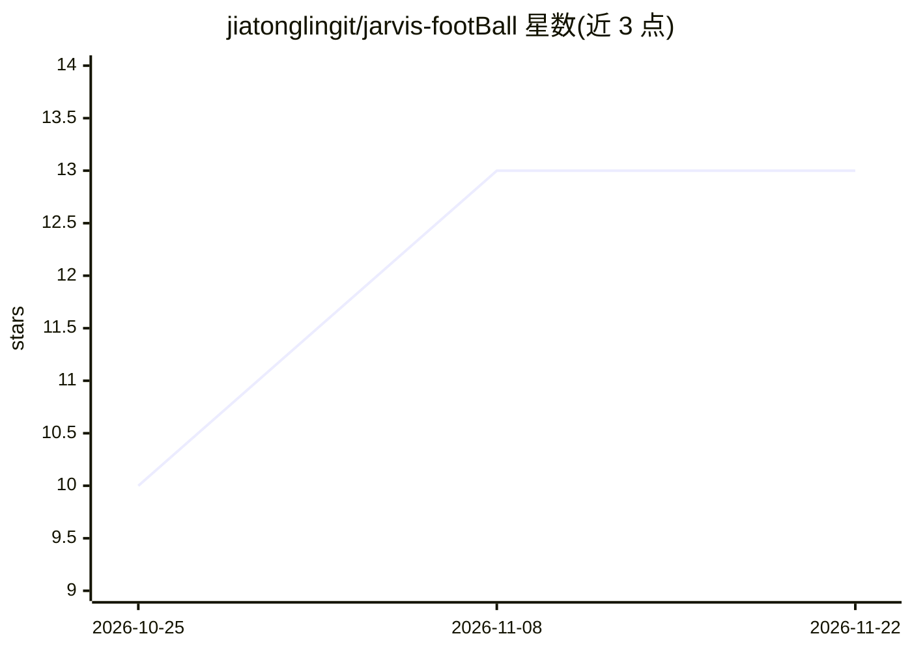

# jiatonglingit/jarvis-footBall

⭐ 13 · MIT · 推送 2026-10-28 · [GitHub](https://github.com/jiatonglingit/jarvis-footBall) · [官网](https://www.jarvis-ai-club.com) · 组织维护 · 中文 README

**面向球迷的足球赛事 AI 分析与数据平台**

Jarvis-FootBall 定位为足球赛事数据与 AI 分析平台，功能入口包括赛事广场（早场与影子模型对照展示、结合比赛状态与盘口）、模型大厅（浏览不同分析模块及历史表现）、全球赛事（联赛/球队/球员资料与对阵比较）及比赛详情（交锋、技术统计、阵容、伤停等）。本仓库仅承担产品介绍、公开使用指南与更新动态；生产系统、核心算法、参数与数据集不在仓库提供，完整产品需在官网体验，部分内容需登录或会员权限。

## 筛选速览

| 维度 | 判定 | 备注 |
|---|---|---|
| AI 角色 | `ai-native` | 本体是模型或模型工具 |
| 许可风险 | `permissive` | MIT |
| 部署形态 | `None` |  |
| 模型依赖 | — | README 未给出锁定关系 |
| 硬件要求 | — | 无带数字的原话,不猜 |
| 安装摩擦 | `low` | 无编译、无系统依赖或容器化 |
| 成熟度 | — | 结构信号不足 |

## 能力要点

- 赛事广场提供早场模型与影子模型对照展示
- 模型大厅集中展示不同分析模块及历史表现
- 全球赛事提供联赛、球队、球员资料与对阵比较
- 仓库仅含产品介绍与公开文档，核心算法不在此仓库

## 适用场景

- 查看当日比赛与赛事分析
- 浏览不同分析模型及其历史表现
- 查询联赛、球队、球员与对阵资料

## 场景标签

`数据分析` · 领域:效率与自动化

## 证据(README 行号)

> L14: Jarvis-FootBall 是一个足球赛事数据与 AI 分析平台。你可以从赛事广场查看比赛，到模型大厅了解不同分析视角，再进入全球赛事查阅联赛、球队、球员与对阵资料。
> L16: **本仓库用于产品介绍、公开使用指南和更新动态。完整产品请在官网体验。**

## 星数曲线

2026-10-25 10 → 2026-11-22 13（+3）

---
*卡片 v1 · prompt 1.4 · 生成 2026-11-18 · 置信度 mid · 依据 README sha `be7657c790a0` · [字段定义](../../DATASET.md)*
