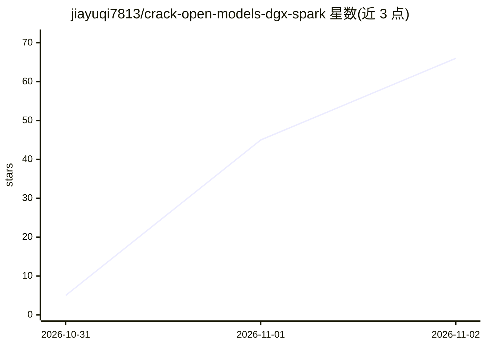

# jiayuqi7813/crack-open-models-dgx-spark

⭐ 66 · Python · MIT · 推送 2026-10-22 · [GitHub](https://github.com/jiayuqi7813/crack-open-models-dgx-spark) · 个人维护

**在双 DGX Spark 上做开源模型行为干预的 Codex 技能**

项目本地化的 Codex skill：分析开源权重模型、选择架构特定的行为干预方案（参考差分、配对激活发现、检查点编辑、运行时 sidecar、有界残差修正与训练回退）、在两节点 NVIDIA DGX Spark 集群上实施，并通过可恢复的证据账本与渐进门禁（plan/candidate/handoff/publish）审计。刻意不含模型名、版本号或历史基准，每次运行从当前检查点与运行时出发。以 git clone 到 skills/ 目录并调用 $crack-open-models-dgx-spark 使用。

## 筛选速览

| 维度 | 判定 | 备注 |
|---|---|---|
| AI 角色 | `ai-ecosystem` | LLM/agent 周边工具 |
| 许可风险 | `permissive` | MIT |
| 部署形态 | `None` |  |
| 模型依赖 | — | README 未给出锁定关系 |
| 硬件要求 | — | 无带数字的原话,不猜 |
| 安装摩擦 | `low` | 无编译、无系统依赖或容器化 |
| 成熟度 | — | 结构信号不足 |

## 能力要点

- 不加载张量负载的 checkpoint/量化/特殊路径清单盘点
- 证据账本驱动的可恢复运行与四级审计门禁
- 要求零编辑编解码往返与量化检查点的可表达性测试
- 模型权重与大规模执行保留在 DGX 节点上

## 适用场景

- 在双 DGX Spark 集群上对开源模型做行为干预（如 refusal-behavior-edit）
- 为模型编辑流程生成证据驱动的路线计划并审计各阶段门禁
- 对量化检查点执行编辑可行性测试与评估配置（smoke/behavior/capability/release）

## 场景标签

 · 领域:模型编辑/LLM 基础设施

## 证据(README 行号)

> L3: A project-local Codex skill for analyzing an open-weight model, choosing the best architecture-specific behavioral i
> L9: - Builds a header-only checkpoint, writer, quantization, and special-path inventory without loading tensor payloads.
> L14: - Tracks the run in a resumable evidence ledger and audits plan, candidate, handoff, and publication gates.

## 星数曲线

2026-10-31 5 → 2026-11-02 66（+61）

---
*卡片 v1 · prompt 1.4 · 生成 2026-10-31 · 置信度 high · 依据 README sha `eb1a4d17f585` · [字段定义](../../DATASET.md)*
