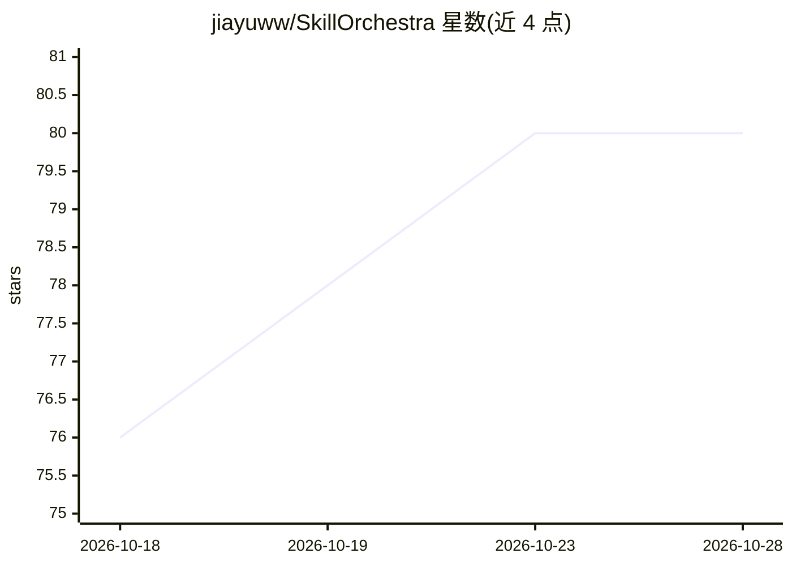

# jiayuww/SkillOrchestra

⭐ 80 · Python · Apache-2.0 · 推送 2026-03-25 · [GitHub](https://github.com/jiayuww/SkillOrchestra) · [官网](https://arxiv.org/abs/2602.19672) · 组织维护

**从执行经验学习技能并按技能路由/编排 agent 的框架**

NeurIPS'26 论文 SkillOrchestra 的官方代码库。框架不端到端学习路由策略，而是从执行轨迹中学习细粒度技能，建模各 agent 在技能下的能力与成本；部署时推断当前交互的技能需求，在显式性能-成本权衡下选择 agent。流水线分 explore/learn/select/test 四阶段，通过 conda 环境加 shell 脚本安装，模型需先用 SGLang 脚本启动服务，学习阶段依赖 OPENAI_API_KEY 或网关 key。支持模型路由与 agent 编排两类任务及模型池、路由策略等配置定制。

## 筛选速览

| 维度 | 判定 | 备注 |
|---|---|---|
| AI 角色 | `ai-ecosystem` | LLM/agent 周边工具 |
| 许可风险 | `permissive` | Apache-2.0 |
| 部署形态 | `None` |  |
| 模型依赖 | — | README 未给出锁定关系 |
| 硬件要求 | — | 无带数字的原话,不猜 |
| 安装摩擦 | `low` | 无编译、无系统依赖或容器化 |
| 成熟度 | — | 结构信号不足 |

## 能力要点

- 从执行轨迹学习技能手册（技能、能力、成本）并支持精炼
- select 阶段生成候选手册并以在线验证选 Pareto 最优
- 部署时按技能需求在性能-成本权衡下选择 agent（--lambda-cost）
- 提供模型路由与 agent 编排（FRAMES 检索任务）两条流水线

## 适用场景

- 研究者在自有模型池上复现技能迁移路由实验
- 为复合 AI 系统构建基于技能的 agent 选择机制
- 在性能与成本之间调节路由策略做消融实验

## 场景标签

`Agent 框架` · 领域:Agent 开发

## 证据(README 行号)

> L3: This repository contains the code for SkillOrchestra, a framework for skill-aware orchestration of compound AI syste
> L75: - `explore` — Run all pool models on the dataset; collect execution traces

## 星数曲线

2026-10-18 76 → 2026-10-28 80（+4）

---
*卡片 v1 · prompt 1.4 · 生成 2026-10-24 · 置信度 high · 依据 README sha `ae1897e21a7f` · [字段定义](../../DATASET.md)*
