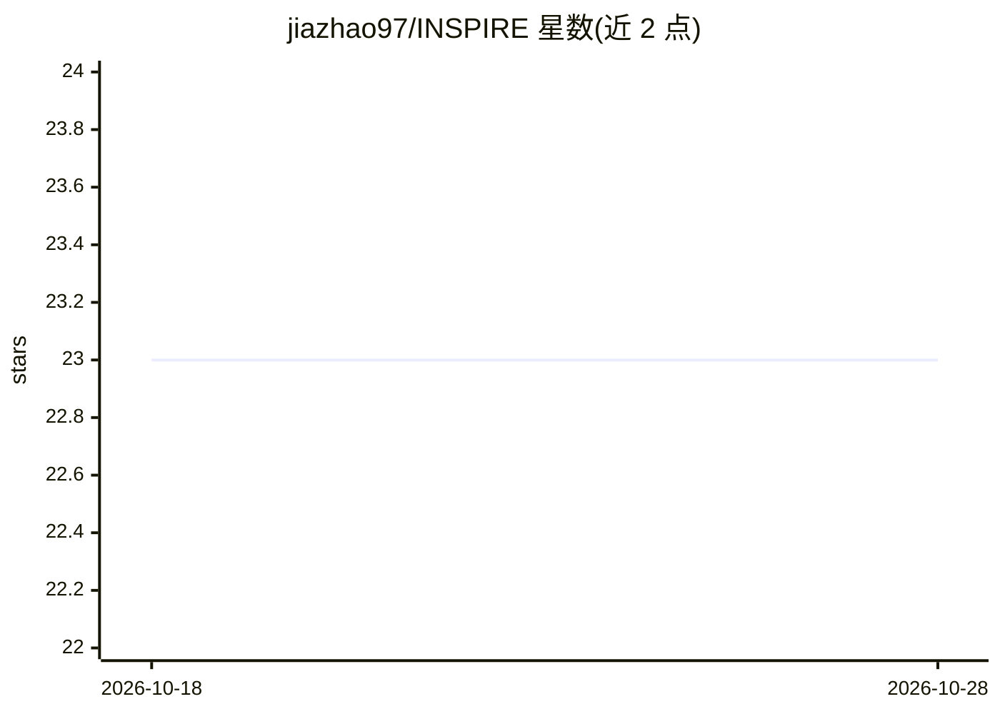

# jiazhao97/INSPIRE

⭐ 23 · Python · 推送 2026-05-28 · [GitHub](https://github.com/jiazhao97/INSPIRE) · [官网](https://inspire-tutorial.readthedocs.io/en/latest/index.html#) · 个人维护

**多来源空间转录组数据整合与解读的深度学习方法**

INSPIRE 是发表于 Nature Genetics 的深度学习方法，用于整合与解读来自不同技术平台、不同生物条件的多个空间转录组（ST）数据集。它将多切片信息映射到共享潜空间，保留有意义的生物变异、消除无关变异，并对跨切片基因表达执行整合 NMF 分解，输出细胞/spot 的潜表示、非负空间因子与非负基因负载。提供基于图注意力网络（GAT）与轻量图卷积网络（LGCN）两种变体：低分辨率平台（如 Visium/ST）推荐 GAT，高分辨率数据推荐 LGCN。输入为 AnnData 格式的基因表达计数矩阵与空间坐标。安装通过 git clone 源码并使用 conda 环境完成，参数（空间因子数、训练步数等）默认即可运行且支持调节。

## 筛选速览

| 维度 | 判定 | 备注 |
|---|---|---|
| AI 角色 | `ai-native` | 本体是模型或模型工具 |
| 许可风险 | `none` | — |
| 部署形态 | `None` |  |
| 模型依赖 | — | README 未给出锁定关系 |
| 硬件要求 | — | 无带数字的原话,不猜 |
| 安装摩擦 | `low` | 无编译、无系统依赖或容器化 |
| 成熟度 | — | 结构信号不足 |

## 能力要点

- 多切片在共享潜空间整合，执行跨数据集整合 NMF 分解
- 输出潜表示、非负空间因子与非负基因负载三类结果
- GAT 与 LGCN 两种变体适配不同分辨率平台
- 空间因子数等参数默认可用并支持按组织规模调节

## 适用场景

- 跨生物重复样本切片整合以提升下游分析准确性
- 整合不同 ST 技术平台切片构建综合空间图谱
- 检测空间变异基因并识别空间架构相关基因程序
- 多相邻切片整合重建器官或胚胎的 3D 结构

## 场景标签

 · 领域:生物信息学/空间转录组学

## 证据(README 行号)

> L15: We develop INSPIRE, a deep learning-based method for integrating and interpreting multiple spatial transcriptomics 
> L17: INSPIRE takes gene expression count matrices and spatial coordinates from multiple ST sections as input, and genera

## 星数曲线

2026-10-18 23 → 2026-10-28 23（+0）

---
*卡片 v1 · prompt 1.4 · 生成 2026-10-27 · 置信度 high · 依据 README sha `0f9cb47c95ac` · [字段定义](../../DATASET.md)*
