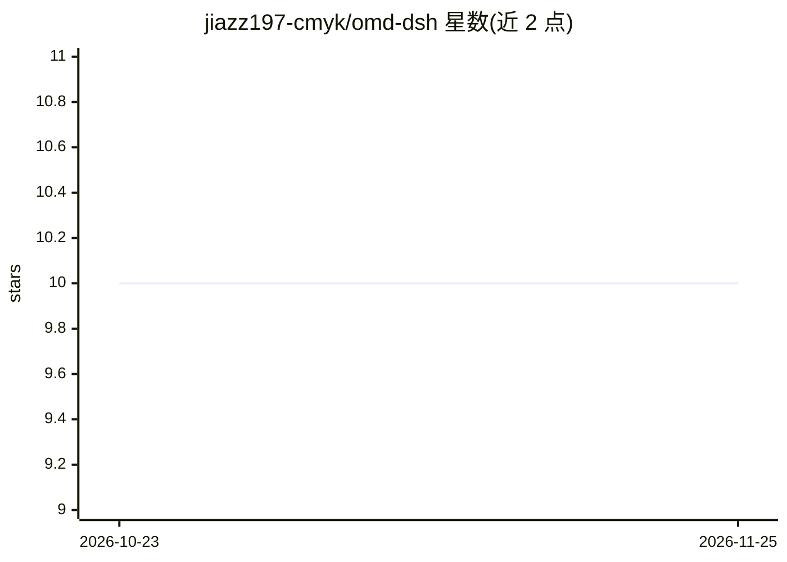

# jiazz197-cmyk/omd-dsh

⭐ 10 · TypeScript · MIT · 推送 2026-08-29 · [GitHub](https://github.com/jiazz197-cmyk/omd-dsh) · [官网](https://www.npmjs.com/package/@carljia/omd-dsh) · 个人维护 · 中文 README

**DeepSeek Harness 的 7 模式 agent 预设插件：分模式模型路由与分层子代理委派**

面向 DeepSeek Harness（DSH）宿主的插件，提供 7 个开箱即用的 agent preset（执行、超能工作、规划、评审、侦察、文献研究、对话），每个模式固定一套工具边界与模型路由；omd_task 按 tier 把重复调查派给 fast 模型、深度推理派给 deep 模型。插件本体是薄接线层，能力复用 DSH 原生 goal/workflow/ralph/subagent/plan-mode 等机制，模型矩阵通过设置页、CLI setup 或手改 omd-matrix.json 编辑。前置要求已装 DSH 与 Node.js ≥20，支持 dsh plugin、npm 全局安装与源码三种方式。

## 筛选速览

| 维度 | 判定 | 备注 |
|---|---|---|
| AI 角色 | `ai-ecosystem` | LLM/agent 周边工具 |
| 许可风险 | `permissive` | MIT |
| 部署形态 | `library` | 以包/库形式分发 |
| 模型依赖 | locked-api |  |
| 硬件要求 | — | 无带数字的原话,不猜 |
| 安装摩擦 | `low` | 无编译、无系统依赖或容器化 |
| 成熟度 | — | 结构信号不足 |

## 能力要点

- 7 个开箱即用模式，各带固定工具边界与模型路由
- omd_task 按 tier 委派：重复工作用 fast 模型、深度推理用 deep 模型
- 模型矩阵三入口：设置页可视化编辑 / CLI setup / 手改 omd-matrix.json
- 自包含 bundle，无需配置 harness 路径

## 适用场景

- 为 DSH 会话按任务类型切换执行/规划/评审等模式
- 让强模型做顶层推理、便宜模型处理重复调查以控制成本
- 规划访谈批准计划后一键 /start-work 自动续跑执行

## 场景标签

`模型网关` · 领域:Agent 开发

## 证据(README 行号)

> L3: > DeepSeek Harness（DSH）的多模式智能体插件 —— 7 个开箱即用的模式，每个模式固定一套能力边界 + 一个模型，`omd_task` 按 tier 把重复/深度工作委派给不同档位的子代理。
> L10: omd-dsh 给 DSH 增加 7 个「模式」（agent preset）。每个模式 = 一套固定的工具边界 + 一个模型路由；同一模式内，`omd_task` 把重复调查/机械活派给便宜模型（fast），把深度推理派给强模型（
> L14: omd-dsh **不重复造轮子**，它是一层很薄的「接线 + 组织」：核心能力大多指向 DSH 原生机制，本插件只负责决定「每个模式用哪些原生能力、配哪个模型」。

## 星数曲线

2026-10-23 10 → 2026-11-25 10（+0）

---
*卡片 v1 · prompt 1.4 · 生成 2026-11-19 · 置信度 high · 依据 README sha `f85a7399409c` · [字段定义](../../DATASET.md)*
