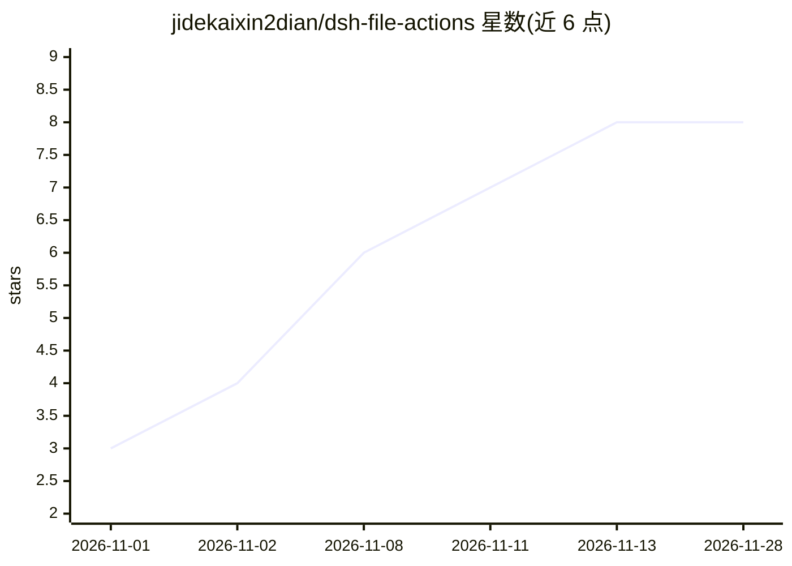

# jidekaixin2dian/dsh-file-actions

⭐ 8 · JavaScript · MIT · 推送 2026-11-21 · [GitHub](https://github.com/jidekaixin2dian/dsh-file-actions) · [官网](https://github.com/jidekaixin2dian/dsh-file-actions#readme) · 个人维护 · 中文 README

**DSH 插件：右键操作 Agent 引用与交付文件，预览与复制**

面向 DeepSeek Harness（DSH）的社区插件，为聊天中出现的文件引用和交付文件提供右键菜单：只读预览引用行及前后文并高亮、一次复制引用正文加路径与行号、在文件管理器中定位、按文件类型设置首选应用，以及图片缩略图/放大、视频取帧和浏览器预览。依赖 DSH>=0.2.1-rc.2 与 Node>=24，通过插件市场或 npm 命令安装，仅适用于 DSH 图形/Web 界面，不适用于终端界面。

## 筛选速览

| 维度 | 判定 | 备注 |
|---|---|---|
| AI 角色 | `ai-enhanced` | 去掉 AI 部分产品仍成立 |
| 许可风险 | `permissive` | MIT |
| 部署形态 | `library` | 以包/库形式分发 |
| 模型依赖 | — | README 未给出锁定关系 |
| 硬件要求 | — | 无带数字的原话,不猜 |
| 安装摩擦 | `low` | 无编译、无系统依赖或容器化 |
| 成熟度 | — | 结构信号不足 |

## 能力要点

- 右键查看引用上下文，复制片段连同相对路径与行号
- 图片缩略图与放大、视频预览帧提取
- 「打开方式」按文件类型记忆首选应用，不改系统默认
- 完整/精简菜单可配置，支持键盘操作（Shift+F10）

## 适用场景

- 在 DSH 会话里快速查看 Agent 引用的代码上下文
- 把带路径和行号的引用复制给他人或另一个会话
- 直接预览和打开对话中交付的图片、视频与文档

## 场景标签

`AI 助手` · 领域:对话与助手

## 证据(README 行号)

> L7: File Actions 为 DeepSeek Harness（DSH）里的文件引用提供右键菜单。从代码行号、交付卡片或图片进入，直接查看上下文、选择应用、预览、定位和复制。
> L101: - 编辑器打开暂不跳到行列位置；另存为使用浏览器下载行为。插件用于 DSH 图形 / Web 界面，终端界面不适用。

## 星数曲线

2026-11-01 3 → 2026-11-28 8（+5）

---
*卡片 v1 · prompt 1.4 · 生成 2026-11-20 · 置信度 high · 依据 README sha `75f970f430c8` · [字段定义](../../DATASET.md)*
