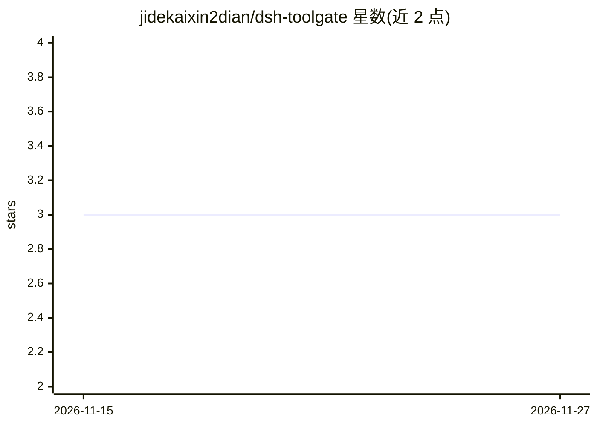

# jidekaixin2dian/dsh-toolgate

⭐ 3 · JavaScript · MIT · 推送 2026-11-25 · [GitHub](https://github.com/jidekaixin2dian/dsh-toolgate) · [官网](https://github.com/jidekaixin2dian/dsh-toolgate#readme) · 个人维护 · 中文 README

**DSH 插件：管理 MCP 服务器与 Skills，控制工具上下文占用**

DeepSeek Harness（DSH）的独立社区插件，提供统一的 MCP、Skill 和上下文预算设置页。按组隐藏当前任务用不到的工具定义，使下一轮 prompt 只携带所需工具，MCP 配置与连接在隐藏期间保持；工具按注册名前缀自动分组，支持自定义规则、三档预设与逐工具开关。token 占用按 schema 与描述长度估算，作者声明不代表实际费用或速度。通过插件市场或 npm 命令安装，要求 DSH>=0.2.1-rc.2 与 Node>=24。

## 筛选速览

| 维度 | 判定 | 备注 |
|---|---|---|
| AI 角色 | `ai-ecosystem` | LLM/agent 周边工具 |
| 许可风险 | `permissive` | MIT |
| 部署形态 | `None` |  |
| 模型依赖 | locked-api |  |
| 硬件要求 | — | 无带数字的原话,不猜 |
| 安装摩擦 | `low` | 无编译、无系统依赖或容器化 |
| 成熟度 | — | 结构信号不足 |

## 能力要点

- 按组隐藏工具定义并保持 MCP 连接，下一轮 prompt 生效
- 工具按注册名自动分组，支持自定义规则与 lite/standard/full 三档预设
- 分发守卫在工具调用前二次拒绝被隐藏的工具
- MCP 编辑写前备份、保留注释，审计记录不含密钥值

## 适用场景

- DSH 会话中上下文窗口紧张时裁剪工具定义
- 统一管理多台 MCP 服务器的启停与配置
- 按工作区会话搜索和启停本地 Skills

## 场景标签

`Agent 框架` · 领域:Agent 开发

## 证据(README 行号)

> L7: Toolgate 为 DeepSeek Harness（DSH）提供统一的 MCP、Skill 和上下文预算设置页。按服务器隐藏当前用不到的工具定义，让下一轮 prompt 聚焦当前任务；需要时恢复，MCP 配置和连接保持。
> L16: |MCP 服务器|新增、编辑、启停、删除服务器；支持 stdio 与 streamable-http|
> L19: 按组隐藏当前任务用不到的工具，需要时一键恢复。配置和运行中的 MCP 保留，下一轮 prompt 使用调整后的工具列表。页面按工具 schema 和描述长度估算 token，占用与实际费用或速度不是同一指标。设置页预算作用于所有会

## 星数曲线

2026-11-15 3 → 2026-11-27 3（+0）

---
*卡片 v1 · prompt 1.4 · 生成 2026-11-21 · 置信度 high · 依据 README sha `7eac979c86e5` · [字段定义](../../DATASET.md)*
