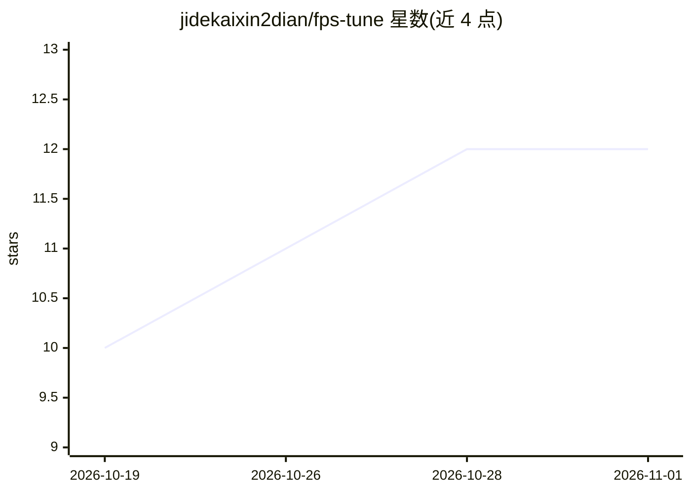

# jidekaixin2dian/fps-tune

⭐ 12 · C# · MIT · 推送 2026-10-31 · [GitHub](https://github.com/jidekaixin2dian/fps-tune) · 个人维护 · 中文 README

**面向 Windows 玩家的系统层 FPS 调校与 A/B 实测工具**

C# WPF + .NET 10 桌面与 CLI 工具：39 项可选系统调校检测、审阅、应用与还原，覆盖 NVIDIA DRS/DLSS 配置、SDR 画面滤镜、分辨率自定义、内存整理、着色器缓存清理、游戏限帧等；每次写入前保存原值，恢复仅处理本工具记录的目标。性能会话记录 CPU/GPU/帧时间，双选两次记录比较平均 FPS、1% LOW 与 P99 并导出 HTML 报告，真实采样需自行安装 PresentMon。不修改游戏文件、不注入进程；带 SKILL.md 供 AI Agent 驱动 CLI。

## 筛选速览

| 维度 | 判定 | 备注 |
|---|---|---|
| AI 角色 | `ai-enhanced` | 去掉 AI 部分产品仍成立 |
| 许可风险 | `permissive` | MIT |
| 部署形态 | `desktop` | 安装包/桌面程序 |
| 模型依赖 | — | README 未给出锁定关系 |
| 硬件要求 | — | 无带数字的原话,不猜 |
| 安装摩擦 | `medium` | 含编译或系统依赖之一 |
| 成熟度 | — | 结构信号不足 |

## 能力要点

- 39 项可还原系统调校，写入前保存原值
- A/B 实验比较平均 FPS、1% LOW、P99，导出 HTML 报告
- 无头 CLI（-Detect/-Apply/-Experiment）+ SKILL.md 供 Agent 驱动
- 备份统一列出并可在同机同用户下导入

## 适用场景

- 游戏开局前一键执行专属准备方案（内存整理、画面滤镜等）
- 用 A/B 实测判断某项优化是否保留
- 按游戏管理 NVIDIA 限帧、DLSS、数字振动与显示参数

## 场景标签

 · 领域:游戏性能/系统工具

## 证据(README 行号)

> L5: 面向 Windows 玩家的系统设置调校与性能测量工具：检测 → 审阅 → 应用 → 实测 → 还原。
> L107: 目录标记 28 项需要管理员、16 项需要重启。CLI 执行 Apply / Restore 即开始操作，需在已同意的范围内使用。

## 星数曲线

2026-10-19 10 → 2026-11-01 12（+2）

---
*卡片 v1 · prompt 1.4 · 生成 2026-11-01 · 置信度 high · 依据 README sha `ff4259ebedb8` · [字段定义](../../DATASET.md)*
